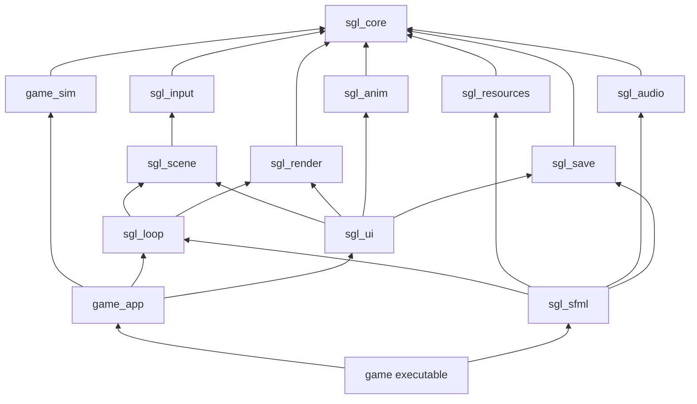
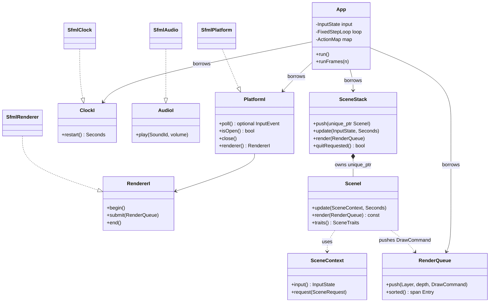
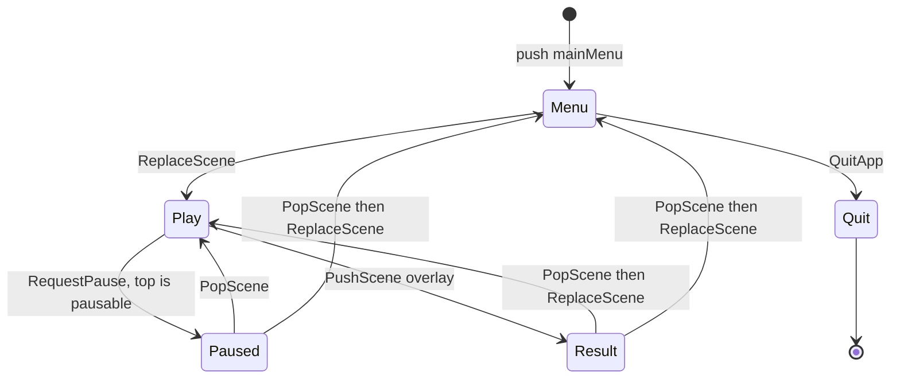
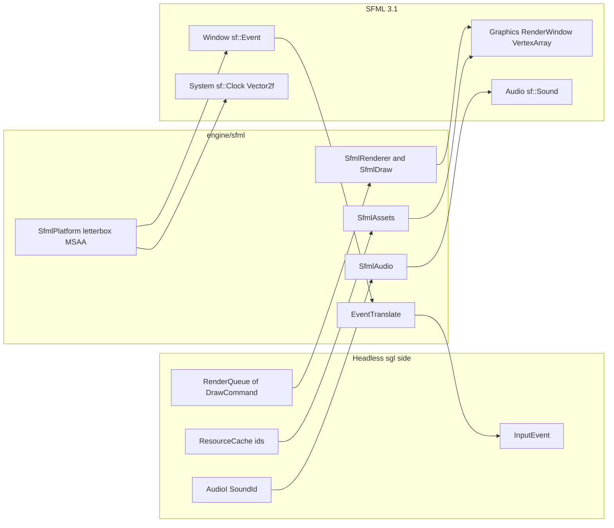

# Engine architecture decisions

This page is the locked contract for **sfml-game-lab** and the source of truth for boundaries and names. The running tree is `engine/` plus the games under `games/<title>/`: Arkanoid, Tetris and Syndicate. The C++ idioms behind these decisions are in [cpp23-and-ownership.md](cpp23-and-ownership.md), and the SFML adapter layer is in [sfml-integration.md](sfml-integration.md).

## Layout and names

| Decision | Choice |
|----------|--------|
| Engine root | `engine/` |
| Engine namespace | `sgl` (no nested `sgl::eng`; the directory already separates the engine) |
| SFML backend | `sgl::sfml` |
| Engine internals | `sgl::detail` |
| Games | `sgl::arkanoid`, `sgl::tetris`, `sgl::syndicate` |
| Includes | `<sgl/<module>/X.hpp>`, `<<game>/<sim\|app>/X.hpp>` |
| Interfaces | Suffix `FooI` (`SceneI`, `RendererI`, `PlatformI`, `ClockI`, `AudioI`) |

Modules are directories, not nested namespaces. Do not write `sgl::render::RenderQueue`.

### Concept names and real types

Generic engine vocabulary does not map one-to-one onto this codebase. Use the real names below in code and docs. The full table is [engine-api-map.md](../reference/engine-api-map.md).

| Generic concept | Real type(s) |
|-----------------|--------------|
| Scene manager | `SceneStack`, driven by `SceneRequest` through `SceneContext` |
| Scene base class | `SceneI` |
| Input manager | `InputState` + `ActionMap`, fed by `InputEvent` |
| Resource manager | `ResourceCache<Id, T>`, owned by `SfmlAssets` / `SfmlAudio` |
| Event manager | None. Events are values: `InputEvent`, `SceneRequest`, and each sim's own event type |
| Core | `sgl_core` value types (`Vec2`, `Rect`, `Color`, `Handle`, `Pcg32`, `Seconds`) |

## Targets

Engine targets:

- `sgl_core` (headers only)
- `sgl_input`, `sgl_scene`, `sgl_loop`, `sgl_render`, `sgl_collision`
- `sgl_resources`, `sgl_audio`, `sgl_fx`, `sgl_anim`, `sgl_save`, `sgl_ui`
- `sgl_sfml`, the only engine target that links SFML

Each game adds `<game>_sim`, `<game>_app`, and an executable `<game>`.

Engine link direction:

- `input`, `collision`, `resources`, `render`, `audio`, `anim` and `save` depend on `core`.
- `scene` depends on `input`.
- `loop` depends on `scene` and `render`.
- `fx` depends on `core` and `render`.
- `ui` depends on `input`, `render`, `scene`, `anim` and `save`.
- `sfml` depends on `loop`, `resources`, `audio` and `save`.

Game link direction:

- `arkanoid_sim` depends on `collision`.
- `tetris_sim` and `syndicate_sim` depend on `core` only.
- Each app depends on its sim and the engine modules it uses.
- Each executable links its app and `sgl_sfml`.



## Boundaries

- Only `engine/sfml` and `games/<game>/main.cpp` may include `<SFML/...>`. `check_boundaries` ([cmake/CheckBoundaries.cmake](../../cmake/CheckBoundaries.cmake)) fails the build otherwise.
- `engine/**` never includes a game header.
- `arkanoid/sim` includes only `sgl/core` and `sgl/collision`. Its input is `SimInput` and its output is `std::vector<SimEvent>`.
- `tetris/sim` and `syndicate/sim` include only `sgl/core`.
- Each module owns its `CMakeLists.txt`. Parallel agents do not edit a shared sources list.

## Ownership and interfaces

`App` owns only what changes per frame: the `InputState`, the `FixedStepLoop` and the moved-in `ActionMap`. It borrows everything else by reference from `main`: the platform, the clock, the scene stack and the render queue. `SceneStack` owns its scenes through `std::unique_ptr<SceneI>`. Scenes never see the stack directly; they get a `SceneContext` that exposes the input and a `request()` sink.



Audio is not part of `PlatformI`. `main` hands `platform.audio()`, or a `ScaledAudio` wrapped around it, to the app's services as an `AudioI&`. Scenes play sounds without knowing about SFML.

## Game loop

`App::runFrame` ([engine/loop/src/App.cpp](../../engine/loop/src/App.cpp)) runs these phases every frame, in order:

1. Poll input.
2. Run the fixed-step updates.
3. Render.

`FixedStepLoop` accumulates real time and returns how many `kTick` steps to run, plus the leftover `alpha`. `kTick` is 1/60 s, and one frame is clamped to at most 0.25 s so a stall cannot cause a spiral of catch-up steps. Scenes always see `dt == kTick`, so the simulation is deterministic for a given input sequence.

```mermaid
sequenceDiagram
  participant App
  participant Platform as PlatformI
  participant Input as InputState
  participant Loop as FixedStepLoop
  participant Stack as SceneStack
  participant Queue as RenderQueue
  participant Renderer as RendererI
  loop every frame
    App->>Input: beginFrame() if last frame ran a step
    loop while poll() returns an event
      App->>Platform: poll()
      App->>Input: apply(event, ActionMap)
    end
    App->>Loop: advance(clock.restart())
    Loop-->>App: steps, alpha
    loop steps times
      App->>Stack: update(input, kTick)
      Stack->>Stack: update scenes top-down until blocksUpdate
      Stack->>Stack: applyRequests()
    end
    App->>Platform: close() if quitRequested or empty
    App->>Queue: clear()
    App->>Stack: render(queue)
    App->>Renderer: begin()
    App->>Renderer: submit(queue)
    App->>Renderer: end()
  end
```

`pressed`, `released` and `focusLost` survive a frame that runs zero fixed steps. `App` clears them at the start of the next frame, but only after a frame that ran at least one scene update. In a multi-step frame they are visible on the first step only. `held` for an action stays true while any bound key is down.

## Scene lifecycle

Scenes change the stack only through `ctx.request(...)` with one of the `SceneRequest` alternatives: `PushScene`, `PopScene`, `ReplaceScene`, `RequestPause` or `QuitApp`. Requests made during `SceneStack::update` are queued and applied after the update walk, so a scene is never destroyed while its own `update` is on the call stack.

`SceneTraits` controls the walks:

- `blocksUpdate` stops the top-down update walk at that scene.
- `opaque` sets where the bottom-up render walk begins.
- `pausable` lets `RequestPause` (or a lost window focus) push the stack's pause factory.

A scene never closes the platform. Quitting is `QuitApp`, or the window closing.



Requests are applied in the order they were made. An overlay that leaves to the menu therefore requests `PopScene` (removing itself) and then `ReplaceScene` (swapping the gameplay scene beneath it). The pause and result overlays are `opaque` false and `blocksUpdate` true, so gameplay stays visible but frozen underneath them. See [pause-overlay.md](../reference/pause-overlay.md).

## SFML 3.1 integration

SFML is an adapter behind four ports: `PlatformI`, `RendererI`, `AudioI` and `ClockI`. Game code builds data (`InputEvent` in, `DrawCommand` out). `engine/sfml` translates that data to SFML types at the edge.



Games draw in a fixed design space, for example 1280x720. `SfmlPlatform` letterboxes that view into any window size and maps mouse pixels back into design coordinates before translating events. Vectors cross the boundary by value: `sgl::Vec2f` becomes `sf::Vector2f{v.x, v.y}`, and `sgl::Color` becomes an `sf::Color` via `toSfColor`. Details are in [sfml-integration.md](sfml-integration.md).

## Simulation vs presentation

Simulation stores positions and sizes as values (`sgl::Vec2f`, `sgl::Rect`). Sprites do not own simulation state. Rendering reads a snapshot and pushes `DrawCommand` into `RenderQueue`, which is sorted by `SortKey` (layer, depth, sequence).

A game's app layer reacts to sim events: sounds, particles, log lines and animations. Syndicate makes this explicit. `Match::apply` takes a command and `drainEvents()` returns what happened. The app then fans those events out to the activity log, the animators and the audio.

## 2.5D

`Projection` is a concept. `Orthographic` and `Isometric` map `Vec3` to a screen position plus depth. Arkanoid uses `Orthographic` and the layers Background, World, Actors, Hud and Overlay.

## ECS

There is no entity-component registry. Entities are plain structs in vectors, updated by free functions. Dynamic polymorphism stays on the ports (`SceneI`, `RendererI`, `PlatformI`, `ClockI`, `AudioI`). Revisit a registry only when a game grows past a handful of component combinations.

## C++23 subset

Allowed: `std::expected`, `std::optional`, `std::variant`, `std::span`, ranges and views, concepts, `std::move_only_function`, `std::to_underlying`, `<=>`, `constexpr`.

Forbidden: `std::mdspan`, `std::flat_map`, `std::print`, exceptions for control flow, raw `new`/`delete`, and function-local static GPU or audio resources.

CI uses GCC 14 and MSVC, so `std::expected` and `std::move_only_function` are available. The reasoning is in [cpp23-and-ownership.md](cpp23-and-ownership.md).

## Randomness

Simulation and particle code use `sgl::Pcg32` only. `std::uniform_int_distribution`, `std::shuffle`, `rand` and wall-clock time are forbidden there, because libstdc++ and MSVC disagree on the standard distributions.

## Effects

Timed effects are data: `std::variant` values with a remaining duration. Derived quantities such as paddle width or ball speed are pure functions of that data. Code does not mutate a value and later undo it.

## Audio, particles, scores, settings

- `AudioI::play` is the audio port. `sgl_audio` stays free of SFML and builds PCM with `tone`, and `ScaledAudio` applies a master volume. `sgl_sfml` implements the port and links `SFML::Audio`.
- `sgl_fx` is a fixed-capacity particle system.
- `sgl_save` stores a descending high-score table and `Settings`, and writes both with a temp file plus rename.

## Games

- **Arkanoid.** Breakout with swept ball collision, stages and data-driven power-ups. See [games/arkanoid/docs/index.md](../../games/arkanoid/docs/index.md).
- **Tetris.** `games/tetris/sim` owns the 10×40 grid (20 visible rows), SRS kicks, the 7-bag, gravity, lock delay, hold, and DAS/ARR in simulation time. `games/tetris/app` maps `InputState` to `TetrisInput`, draws with `DrawCommand`, plays events through `AudioI`, and writes `tetris.scores`. See [games/tetris/docs/index.md](../../games/tetris/docs/index.md).
- **Syndicate.** A hot-seat economic board game with an integer-only `Match` command and event machine, a ring-graph board, and a presentation layer built from `sgl_ui` and `sgl_anim`. See [games/syndicate/docs/index.md](../../games/syndicate/docs/index.md).
