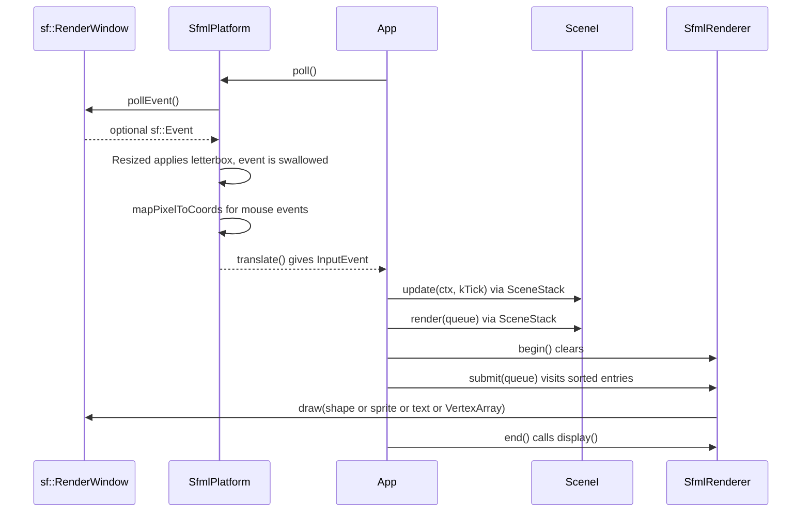

# SFML 3.1 integration

SFML 3.1 is fetched by [cmake/FetchSFML.cmake](../../cmake/FetchSFML.cmake), with the Graphics, Window, System and Audio modules; Network stays off. It is linked only by `sgl_sfml`. Games see it through four ports (`PlatformI`, `RendererI`, `AudioI`, `ClockI`) and never include an SFML header outside `games/<game>/main.cpp`. This page explains how the adapter works. Exact signatures are in [engine-sfml.md](../reference/engine-sfml.md).

## Why an adapter at all

- **Tests stay headless.** Every suite except `event_translate_test` runs without SFML symbols, and even that suite opens no window. Scenes are exercised with `PlatformMock`, `RendererMock` and `ClockMock`.
- **Rendering is data.** A scene's `render` pushes `DrawCommand` values. Tests can assert "a red `RectCmd` at (x, y) on `Layer::Hud`" without pixels.
- **One place for SFML 3 API churn.** SFML 3 moved to `std::optional<sf::Event>` with `getIf<T>()`, scoped enums (`sf::Keyboard::Key::A`), vector-based setters (`setPosition({x, y})`) and `sf::Angle` for rotations. Only `engine/sfml` has to track this.

## Module map

| SFML module | Used for | Adapter |
|-------------|----------|---------|
| Window | `sf::Event`, keyboard / mouse enums, `sf::ContextSettings` | `EventTranslate.hpp`, `SfmlPlatform` |
| Graphics | `sf::RenderWindow`, `sf::View`, shapes, `sf::Sprite`, `sf::Text`, `sf::VertexArray`, `sf::Texture`, `sf::Font` | `SfmlRenderer`, `SfmlDraw.hpp`, `SfmlAssets` |
| Audio | `sf::SoundBuffer`, `sf::Sound` | `SfmlAudio` |
| System | `sf::Clock`, `sf::Vector2f` / `sf::Vector2u`, `sf::Angle` | `SfmlClock`, conversions |

## Frame path



## Coordinates and vectors

All game code works in **design coordinates**: a fixed logical space passed to `SfmlPlatform{{1280u, 720u}, title}`. The origin is at the top left, +x points right and +y points down, the unit is one design pixel, and angles are in degrees unless a name says otherwise (`rotationDeg`).

`sgl::Vec2f` and `sf::Vector2f` have the same meaning but are different types. The engine converts explicitly at the boundary, by value, with brace initialization:

```cpp
shape.setPosition({cmd.rect.pos.x + halfW, cmd.rect.pos.y + halfH}); // sgl -> sf
return sgl::MouseMove{.pos = {designPosition.x, designPosition.y}};    // sf -> sgl
```

There is no implicit conversion operator. Keeping the conversion explicit is what keeps `sgl_core` free of SFML.

## Letterboxing and the view

`SfmlPlatform` keeps an `sf::View` covering exactly the design rectangle. On creation and on every `Resized` event, `applyLetterbox` compares aspect ratios:

\[
r_w = \frac{W}{H}, \qquad r_d = \frac{w_d}{h_d}
\]

If \(r_w > r_d\) the window is wider than the design, so the viewport width becomes \(r_d / r_w\) and the leftover is split evenly left and right (pillarbox). Otherwise the viewport height becomes \(r_w / r_d\), with bars at the top and bottom (letterbox). The game never sees the physical window size.

Mouse positions go the other way. `pointerPixel` extracts the pixel from the event, and `window.mapPixelToCoords` maps it through the view, so `InputEvent` pointer positions are already in design coordinates.

Windowed and fullscreen modes are recreated through `setDisplay(WindowMode, size)`. It re-creates the window with `antiAliasingLevel = 4` (MSAA), disables key repeat, caps the frame rate at 60, and reapplies the letterbox.

## Transforms: how draw commands map to SFML

SFML positions a transformable by its **origin**, and rotates and scales around that origin. The `DrawCommand` types instead describe the unrotated top-left corner, so each adapter in [SfmlDraw.hpp](../../engine/sfml/include/sgl/sfml/SfmlDraw.hpp) moves the origin explicitly:

| Command | sgl meaning | SFML mapping |
|---------|-------------|--------------|
| `RectCmd` | `rect.pos` is the top left, rotated around the center | origin = half size; position = `pos + size / 2`; `sf::degrees(rotationDeg)` |
| `LineCmd` | segment `from` to `to`, `thickness` | a rectangle of length \(\lvert to - from \rvert\) and height `thickness`, origin at the left middle, rotated by `sf::radians(atan2(dy, dx))` |
| `CircleCmd` | `center`, `radius`, `points` | origin = (radius, radius); position = center |
| `SpriteCmd` | `position` is the top left of the scaled source rect | texture rect from `source`; origin = source center; position = `position + half * scale` |
| `TextCmd` | `Anchor::TopLeft` or `Anchor::Center` | for `Center`, origin = the center of the local bounds |
| `MeshCmd` | vertices with color and UV; `Triangles` / `TriangleStrip` | `sf::VertexArray`; drawn with `RenderStates.texture` when `texture` is set |

`MeshCmd` backs the procedural chrome built by the free functions in `<sgl/render/Shapes.hpp>`: `roundedRect`, `roundedRectOutline`, `verticalGradient`, `radialGlow`, `polyline` and `arrowHead`. One command becomes one `VertexArray` draw, rather than a shape object per segment.

If a command refers to a missing texture or font, the renderer skips it and increments `skippedCommands()` instead of crashing. A headless test can check that counter.

## Draw order

`RenderQueue::sorted()` orders entries by `SortKey{layer, depth, seq}`. The layers are `Background`, `World`, `Actors`, `Hud` and `Overlay`; `depth` orders items within a layer, and `seq` keeps push order stable for equal keys. The renderer therefore needs no z-buffer, and scene render order does not leak into visual order.

## Resources

`SfmlAssets` owns two `ResourceCache`s, one for `sf::Texture` and one for `sf::Font`. Textures come from an in-memory `sgl::Image` (procedural art) or from a file (`textureFile`, returning `std::optional`, used for the optional atlas PNG). Fonts come from a file. Every load is keyed by a string, so loading the same key twice returns the existing id. Games keep only `TextureId` / `FontId` handles. The renderer resolves them with `assets.get(id)` at draw time.

## Audio

`SfmlAudio::upload(key, Pcm)` turns engine-generated mono PCM into an `sf::SoundBuffer` stored in a `ResourceCache`. `play(id, volume)` looks for a free or stopped voice among 16 `std::optional<sf::Sound>` slots. When none is free it steals the oldest started voice, so bursts of sounds never allocate unboundedly or fail. The volume is clamped to \([0, 1]\) and scaled to SFML's 0 to 100. `ScaledAudio` in `sgl_audio` wraps any `AudioI` to apply the master volume from `Settings`.

## Lifetime

`SfmlPlatform` declares its members as window, assets, audio, then renderer, so they are destroyed in the reverse order. The window and GL context outlive every texture and font, and the audio device outlives every voice. See [cpp23-and-ownership.md](cpp23-and-ownership.md).
