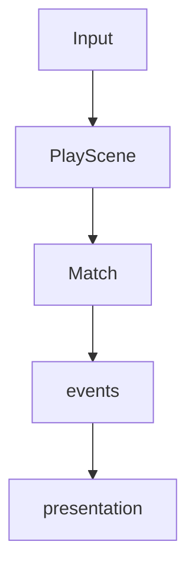

# Syndicate UI presentation

C++/SFML can draw UI chrome **procedurally**. The engine already wraps `sf::VertexArray` meshes as `sgl::MeshCmd`, and `Shapes` builds rounded rects, gradients, radial glows, polylines, and arrows. `SfmlPlatform` opens the window with MSAA (`antiAliasingLevel` 4), so soft edges stay acceptable without shaders. Shaders are unnecessary for this phase.

Raster PNG is reserved for **icons**, **card art**, and **backgrounds**. Everything else (panels, buttons, dice pips, board chrome) stays mesh-based until an optional atlas supplies a region.

## Hybrid model

1. Procedural chrome is always available.
2. An optional atlas (`atlas.png` + `atlas.txt`) may be loaded into `SpriteBank`.
3. Missing keys return `nullopt` from `SpriteBank::sprite` → fall back to procedural draw.

The game stays playable with zero PNGs.

## Presentation stays outside the sim

`Match::apply` is instant and headless. Animators (`PawnAnimator`, feedback FX, future card flips) live in the app layer and interpret `GameEvent` streams after each command. The sim never knows about sprites or meshes.

