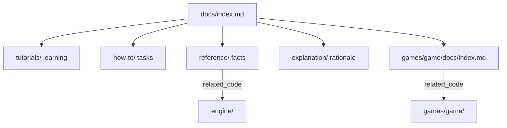

# Documentation map

Documentation for **sfml-game-lab** follows the [Diataxis](https://diataxis.fr/) framework and lives in two kinds of tree:

- `docs/` (this tree) covers the `sgl` engine and anything shared across games.
- `games/<game>/docs/` covers one game. Each has its own `index.md` with the same four quadrants.

Every document starts with a YAML front-matter block. To find the page for a source file, search both `docs/` and `games/*/docs/` for that path in `related_code`.

## How the docs are organized

| Quadrant | When to read | Purpose |
|----------|--------------|---------|
| Tutorials | First time with the repo | Learn by doing, end to end |
| How-to | You have a specific task | Steps to reach a goal |
| Reference | You need a precise fact | Describe what exists, mirrors code |
| Explanation | You want the "why" | Design rationale and direction |

## Where to start

| You are working on | Read first |
|--------------------|------------|
| The engine (`engine/`) | [explanation/architecture.md](explanation/architecture.md), then the matching `reference/engine-*.md` |
| An existing game | That game's `games/<game>/docs/index.md` |
| A new game | [how-to/add-a-game.md](how-to/add-a-game.md) and a sibling game's docs as a model |

## Engine and cross-game documents

| Document | Type | Keywords |
|----------|------|----------|
| [tutorials/getting-started.md](tutorials/getting-started.md) | tutorial | setup, toolchain, build, run, msys2 |
| [how-to/build-and-test.md](how-to/build-and-test.md) | how-to | build, test, ctest, format, presets |
| [how-to/add-a-game.md](how-to/add-a-game.md) | how-to | game, cmake, check_boundaries, sim, app |
| [reference/source-layout.md](reference/source-layout.md) | reference | layout, directories, sgl, targets, suites |
| [reference/engine-core.md](reference/engine-core.md) | reference | sgl, Vec2, Rect, Handle, Image, Overloaded |
| [reference/engine-audio.md](reference/engine-audio.md) | reference | sgl, AudioI, tone, Pcm, SfmlAudio |
| [reference/engine-ui.md](reference/engine-ui.md) | reference | sgl, MenuModel, renderMenu, PauseOverlay |
| [reference/engine-input.md](reference/engine-input.md) | reference | InputEvent, ActionMap, InputState |
| [reference/engine-scene.md](reference/engine-scene.md) | reference | SceneStack, SceneRequest, pause |
| [reference/engine-loop.md](reference/engine-loop.md) | reference | FixedStepLoop, App, PlatformI |
| [reference/engine-render.md](reference/engine-render.md) | reference | RenderQueue, SortKey, Projection |
| [reference/engine-fx.md](reference/engine-fx.md) | reference | sgl, ParticleSystem, BurstParams, Pcg32 |
| [reference/engine-anim.md](reference/engine-anim.md) | reference | sgl, Easing, Tween, Spline, ArcLengthTable |
| [reference/engine-collision.md](reference/engine-collision.md) | reference | intersect, sweep, reflect |
| [reference/engine-resources.md](reference/engine-resources.md) | reference | ResourceCache, ResourceError |
| [reference/engine-save.md](reference/engine-save.md) | reference | sgl, HighScoreTable, SaveError, userDataDir |
| [reference/engine-sfml.md](reference/engine-sfml.md) | reference | SfmlPlatform, EventTranslate, letterbox |
| [reference/input-and-events.md](reference/input-and-events.md) | reference | InputEvent, ActionMap, defaultBindings |
| [reference/pause-overlay.md](reference/pause-overlay.md) | reference | PauseScene, RequestPause, FocusLost, pausable |
| [explanation/roadmap.md](explanation/roadmap.md) | explanation | roadmap, stages, power-ups, engine split |
| [explanation/architecture.md](explanation/architecture.md) | explanation | ADR, sgl, boundaries, ECS |

## Game documentation

| Game | Index | Covers |
|------|-------|--------|
| Arkanoid | [games/arkanoid/docs/index.md](../games/arkanoid/docs/index.md) | sim, app |
| Tetris | [games/tetris/docs/index.md](../games/tetris/docs/index.md) | sim, app |
| Syndicate | [games/syndicate/docs/index.md](../games/syndicate/docs/index.md) | design, UI, sim, economy, cards, auction, app, assets |

## Design notes (not Diátaxis)

| Document | Purpose |
|----------|---------|
| [../mvp/README.md](../mvp/README.md) | prospective engine plan |
| [../mvp/10-engine-progress.md](../mvp/10-engine-progress.md) | living tracker: slices, sgl modules, games |

`mvp/01`–`09` are prospective. Current facts live in the Diátaxis pages; prefer `engine/` and `games/` over chapter prose if they disagree.

## Maintenance

Documentation currency is enforced by the always-on rule `.cursor/rules/documentation.mdc` and the `update-docs` skill. When code changes, update the docs whose `related_code` lists the touched files (in either tree), refresh their `last_reviewed`, and keep this map and the per-game indexes in sync.
