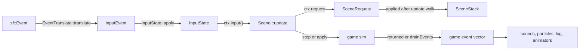

# Events

`sgl` has no event manager, bus or observer registry. Events are `std::variant` values that flow along three fixed channels. Each channel has one producer and one consumer, so the order and the lifetime of every event are clear.

## Input events

| Item | Value |
|------|-------|
| Type | `sgl::InputEvent = std::variant<KeyDown, KeyUp, MouseMove, MouseDown, MouseUp, WindowClosed, FocusLost, FocusGained>` |
| Header | `<sgl/input/InputEvent.hpp>` |
| Producer | `PlatformI::poll()`. `SfmlPlatform` uses `sgl::sfml::translate` from `EventTranslate.hpp`; unmapped keys become `Key::Unknown` |
| Consumer | `InputState::apply(event, ActionMap)`, called by `App` for every polled event |
| Seen by scenes as | `ActionState{pressed, held, released}` via `input.action(id)`, `input.axis(id)`, `pointer()`, `pointerPressed()`, `pointerReleased()`, `closeRequested()`, `focusLost()` |
| Coordinates | mouse positions are already in design coordinates (letterboxed view) |

Scenes never see an `InputEvent` directly. Edge flags (`pressed`, `released`, `pointerPressed`, `focusLost`) survive a frame that runs no fixed step, and are cleared once a frame has run at least one step. `WindowClosed` sets `closeRequested()`, and `App` then closes the platform.

## Scene requests

| Item | Value |
|------|-------|
| Type | `sgl::SceneRequest = std::variant<PushScene, PopScene, ReplaceScene, RequestPause, QuitApp>` |
| Header | `<sgl/scene/SceneRequest.hpp>` |
| Producer | `SceneContext::request(SceneRequest)` inside `SceneI::update` |
| Consumer | `SceneStack`. Requests are queued during the update walk and applied after it, in order |
| Payload | `PushScene` / `ReplaceScene` carry a `SceneFactory` (`std::move_only_function<std::unique_ptr<SceneI>()>`) |
| Special cases | `RequestPause` is dropped unless the top scene is `pausable`. At most one pause is queued per update. `FocusLost` enqueues the same pause. `QuitApp` sets `quitRequested()` |

## Game events

Each sim defines its own variant. The engine never sees these types.

| Game | Type | Alternatives | Producer | Consumer |
|------|------|--------------|----------|----------|
| Arkanoid | `sgl::arkanoid::SimEvent` | `BrickDestroyed`, `LifeLost`, `StageCleared`, `GameOver`, `PowerUpCaught`, `PaddleHit`, `WallHit`, `BallLaunched`, `BallLost` | returned by `step(State&, const SimInput&, Seconds)` | gameplay scene: sounds, particles, result overlay |
| Tetris | `sgl::tetris::TetrisEvent` | `PieceSpawned`, `PieceShifted`, `PieceRotated`, `PieceLocked`, `LinesCleared`, `HardDropped`, `HoldUsed`, `LevelUp`, `GameOver` | returned by `TetrisGame::step(const TetrisInput&, Seconds)` | play scene: sounds, feedback, game-over overlay |
| Syndicate | `sgl::syndicate::GameEvent` | `Rolled`, `Moved`, `PaydayPaid`, `FeePaid`, `Liquidated`, `SharesBought`, `AuctionDone`, `CardPlayed`, `TradeResolved`, `MarketShifted`, `GameEnded` | accumulated by `Match::apply(command)` | `PlayScene::drainFeedback` via `Match::drainEvents()` |

### Fan-out pattern

The consumer takes the whole batch once per tick and hands it to each presentation subsystem in turn. Syndicate's `PlayScene::drainFeedback` does this:

1. `match_->drainEvents()` moves the pending events out of the match.
2. `Rolled` goes to `Presentation::onRolled`, which starts the dice animation.
3. The full vector goes to `Feedback::onEvents` for sounds and particles.
4. Each event is described into the `ActivityLog`, using `std::visit` with `sgl::Overloaded` to pick the acting player.

To add a new game event:

- Add a struct and list it in the variant.
- Emit it from the sim.
- Handle it in the consumers. Exhaustive `std::visit` calls (`Overloaded` visitors without a generic fallback) stop compiling until they cover it. Consumers that use `std::get_if` must be checked by hand.
- Update the game's `reference/sim.md`.
