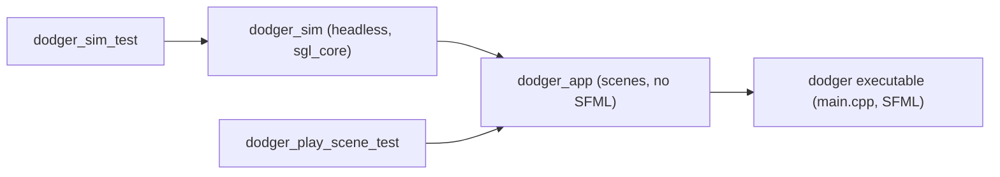
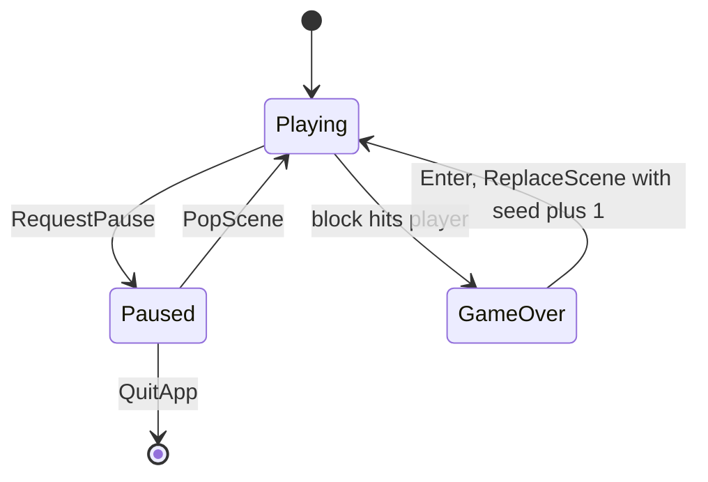

# Building your first game on the sgl engine

In this tutorial you build **Dodger**, a complete small game: blocks fall from the top of a 1280x720 field and you slide a paddle left and right to avoid them. By the end you will have a headless simulation with deterministic tests, a scene that draws with `RenderQueue`, keyboard bindings, a working pause overlay, and an executable.

Every snippet below compiles against the current engine with `-Werror` and passes its tests. That was checked before this page was written. Dodger is not committed to the repository, so type it in yourself.

You need a working Debug build first. Follow [getting-started.md](getting-started.md) if `cmake --preset debug` has not been run yet.



## Step 1: Create the directories and targets

Create this tree:

```
games/dodger/
  CMakeLists.txt
  main.cpp
  sim/CMakeLists.txt
  sim/include/dodger/sim/Sim.hpp
  sim/src/Sim.cpp
  app/CMakeLists.txt
  app/include/dodger/app/Bindings.hpp
  app/include/dodger/app/PlayScene.hpp
  app/src/Bindings.cpp
  app/src/PlayScene.cpp
tests/dodger/sim/CMakeLists.txt
tests/dodger/sim/SimTest.cpp
tests/dodger/app/CMakeLists.txt
tests/dodger/app/PlaySceneTest.cpp
```

Register the game in `games/CMakeLists.txt`:

```cmake
add_subdirectory(dodger)
```

Then register the tests in `tests/CMakeLists.txt`, next to the other games:

```cmake
add_subdirectory(dodger/sim)
add_subdirectory(dodger/app)
```

`games/dodger/CMakeLists.txt` mirrors Tetris. `check_boundaries` runs before the executable links:

```cmake
add_subdirectory(sim)
add_subdirectory(app)

add_executable(dodger main.cpp)
target_compile_features(dodger PRIVATE cxx_std_23)
target_compile_options(dodger PRIVATE ${BASE_COMPILE_FLAGS})
target_link_libraries(dodger PRIVATE dodger_app sgl_sfml)
file(TO_CMAKE_PATH "${CMAKE_SOURCE_DIR}/assets" ASSET_DIR_NORM)
target_compile_definitions(dodger PRIVATE ASSET_DIR="${ASSET_DIR_NORM}")
add_dependencies(dodger check_boundaries)
```

`games/dodger/sim/CMakeLists.txt` links only `sgl_core`:

```cmake
add_library(dodger_sim STATIC
    src/Sim.cpp
)
target_include_directories(dodger_sim PUBLIC
    ${CMAKE_CURRENT_SOURCE_DIR}/include
)
target_compile_features(dodger_sim PUBLIC cxx_std_23)
target_compile_options(dodger_sim PRIVATE ${BASE_COMPILE_FLAGS})
target_link_libraries(dodger_sim PUBLIC sgl_core)
```

`games/dodger/app/CMakeLists.txt` adds the engine modules the scene uses. `sgl_ui` brings in `PauseOverlay`:

```cmake
add_library(dodger_app STATIC
    src/Bindings.cpp
    src/PlayScene.cpp
)
target_include_directories(dodger_app PUBLIC
    ${CMAKE_CURRENT_SOURCE_DIR}/include
)
target_compile_features(dodger_app PUBLIC cxx_std_23)
target_compile_options(dodger_app PRIVATE ${BASE_COMPILE_FLAGS})
target_link_libraries(dodger_app PUBLIC
    dodger_sim
    sgl_scene
    sgl_render
    sgl_ui
)
```

Every `.cpp` you add later must be listed in the `CMakeLists.txt` of the module that owns it. Otherwise it never compiles.

## Step 2: Write the headless simulation

The simulation is plain data plus a `step` function that advances exactly one fixed tick (`sgl::kTick`, 1/60 s). It never reads a clock and never uses `std::` random distributions. All randomness comes from a seeded `sgl::Pcg32`, so a seed and an input sequence always produce the same game.

`games/dodger/sim/include/dodger/sim/Sim.hpp`:

```cpp
#pragma once

#include <cstdint>
#include <sgl/core/Random.hpp>
#include <sgl/core/Rect.hpp>
#include <sgl/core/Vec2.hpp>
#include <vector>

namespace sgl::dodger
{

inline constexpr float kFieldWidth{1280.f};
inline constexpr float kFieldHeight{720.f};
inline constexpr float kPlayerY{660.f};
inline constexpr sgl::Vec2f kPlayerSize{64.f, 24.f};
inline constexpr sgl::Vec2f kBlockSize{40.f, 40.f};
inline constexpr float kPlayerSpeed{8.f};
inline constexpr float kBlockSpeed{5.f};
inline constexpr std::uint32_t kSpawnEvery{30};

struct Input
{
    bool left{};
    bool right{};
};

struct State
{
    float playerX{(kFieldWidth - kPlayerSize.x) * 0.5f};
    std::vector<sgl::Vec2f> blocks;
    sgl::Pcg32 rng{1};
    std::uint32_t tick{};
    std::uint32_t score{};
    bool over{};
};

[[nodiscard]] State makeState(std::uint64_t seed);
[[nodiscard]] sgl::Rect<float> playerRect(const State& state);
void step(State& state, Input input);

} // namespace sgl::dodger
```

Speeds are in design pixels per tick, not per second. Because every tick has the same length, there is no `dt` to multiply by and no floating-point drift between machines.

`games/dodger/sim/src/Sim.cpp`:

```cpp
#include <algorithm>
#include <dodger/sim/Sim.hpp>

namespace sgl::dodger
{

State makeState(std::uint64_t seed)
{
    State state{};
    state.rng = sgl::Pcg32{seed};
    return state;
}

sgl::Rect<float> playerRect(const State& state)
{
    return sgl::Rect<float>{{state.playerX, kPlayerY}, kPlayerSize};
}

void step(State& state, Input input)
{
    if(state.over)
    {
        return;
    }

    if(input.left)
    {
        state.playerX -= kPlayerSpeed;
    }
    if(input.right)
    {
        state.playerX += kPlayerSpeed;
    }
    state.playerX = std::clamp(state.playerX, 0.f, kFieldWidth - kPlayerSize.x);

    if(state.tick % kSpawnEvery == 0)
    {
        const auto columns = static_cast<std::uint32_t>(kFieldWidth / kBlockSize.x);
        const float x = static_cast<float>(state.rng.uniformBelow(columns)) * kBlockSize.x;
        state.blocks.push_back({x, -kBlockSize.y});
    }
    ++state.tick;

    for(sgl::Vec2f& block: state.blocks)
    {
        block.y += kBlockSpeed;
    }

    const sgl::Rect<float> player = playerRect(state);
    for(const sgl::Vec2f& block: state.blocks)
    {
        if(player.intersects(sgl::Rect<float>{block, kBlockSize}))
        {
            state.over = true;
            return;
        }
    }

    const std::size_t before = state.blocks.size();
    std::erase_if(state.blocks, [](const sgl::Vec2f& block) { return block.y > kFieldHeight; });
    state.score += static_cast<std::uint32_t>(before - state.blocks.size());
}

} // namespace sgl::dodger
```

## Step 3: Test the simulation before drawing anything

Rules come first, and they are tested with no window. `tests/dodger/sim/CMakeLists.txt`:

```cmake
add_unit_test(dodger_sim_test
    SOURCES
        SimTest.cpp
    DEPENDENCIES
        dodger_sim
)
```

`tests/dodger/sim/SimTest.cpp`:

```cpp
#include <dodger/sim/Sim.hpp>
#include <gtest/gtest.h>

using namespace sgl::dodger;

TEST(DodgerSimShould, spawnBlockOnFirstTick)
{
    State state = makeState(7);
    step(state, Input{});
    ASSERT_EQ(state.blocks.size(), 1u);
    EXPECT_FLOAT_EQ(state.blocks[0].y, -kBlockSize.y + kBlockSpeed);
}

TEST(DodgerSimShould, beDeterministicForSeed)
{
    State a = makeState(123);
    State b = makeState(123);
    for(int i = 0; i < 600; ++i)
    {
        step(a, Input{.right = i % 50 < 25});
        step(b, Input{.right = i % 50 < 25});
    }
    EXPECT_EQ(a.blocks, b.blocks);
    EXPECT_EQ(a.score, b.score);
    EXPECT_EQ(a.over, b.over);
}

TEST(DodgerSimShould, endWhenBlockHitsPlayer)
{
    State state = makeState(1);
    state.blocks = {{state.playerX, kPlayerY - kBlockSpeed}};
    state.tick = 1;
    step(state, Input{});
    EXPECT_TRUE(state.over);
}
```

Build and run it:

```sh
cmake --preset debug
cmake --build --preset debug --target dodger_sim_test
ctest --preset debug -R dodger_sim_test
```

The determinism test is the important one. If it ever fails, something in the sim is reading state from outside (a clock, a static, or an unseeded random source).

## Step 4: Define actions and key bindings

Scenes never look at raw keys. They ask `InputState` about **actions**, and `ActionMap` decides which keys trigger which actions. One key may trigger several actions, and one action may have several keys.

`games/dodger/app/include/dodger/app/Bindings.hpp`:

```cpp
#pragma once

#include <sgl/input/ActionId.hpp>
#include <sgl/input/ActionMap.hpp>
#include <sgl/ui/MenuActions.hpp>

namespace sgl::dodger
{

struct Actions
{
    sgl::ActionId left{};
    sgl::ActionId right{};
    sgl::ActionId up{};
    sgl::ActionId down{};
    sgl::ActionId confirm{};
    sgl::ActionId cancel{};
    sgl::ActionId pause{};
};

[[nodiscard]] Actions makeActions();
[[nodiscard]] sgl::ActionMap defaultBindings(const Actions& actions);
[[nodiscard]] sgl::MenuActions menuActions(const Actions& actions);

} // namespace sgl::dodger
```

`games/dodger/app/src/Bindings.cpp`. Escape is bound to both `pause` (read by the play scene) and `cancel` (read by the pause overlay to resume):

```cpp
#include <dodger/app/Bindings.hpp>
#include <sgl/input/Key.hpp>

namespace sgl::dodger
{

Actions makeActions()
{
    return Actions{
        .left = sgl::ActionId{.id = 1},
        .right = sgl::ActionId{.id = 2},
        .up = sgl::ActionId{.id = 3},
        .down = sgl::ActionId{.id = 4},
        .confirm = sgl::ActionId{.id = 5},
        .cancel = sgl::ActionId{.id = 6},
        .pause = sgl::ActionId{.id = 7},
    };
}

sgl::ActionMap defaultBindings(const Actions& actions)
{
    sgl::ActionMap map;
    map.bind(sgl::Key::Left, actions.left);
    map.bind(sgl::Key::A, actions.left);
    map.bind(sgl::Key::Right, actions.right);
    map.bind(sgl::Key::D, actions.right);
    map.bind(sgl::Key::Up, actions.up);
    map.bind(sgl::Key::Down, actions.down);
    map.bind(sgl::Key::Enter, actions.confirm);
    map.bind(sgl::Key::Backspace, actions.cancel);
    map.bind(sgl::Key::Escape, actions.pause);
    map.bind(sgl::Key::Escape, actions.cancel);
    return map;
}

sgl::MenuActions menuActions(const Actions& actions)
{
    return sgl::MenuActions{
        .up = actions.up,
        .down = actions.down,
        .confirm = actions.confirm,
        .cancel = actions.cancel,
    };
}

} // namespace sgl::dodger
```

## Step 5: Write the play scene

A scene implements `sgl::SceneI`:

- `update` runs once per fixed tick and may send requests to the stack.
- `render` pushes draw commands. It is `const`, so drawing cannot change the game.
- `traits` tells the stack how to treat the scene.

`games/dodger/app/include/dodger/app/PlayScene.hpp`:

```cpp
#pragma once

#include <cstdint>
#include <dodger/app/Bindings.hpp>
#include <dodger/sim/Sim.hpp>
#include <sgl/render/AssetIds.hpp>
#include <sgl/scene/SceneI.hpp>
#include <sgl/scene/SceneRequest.hpp>

namespace sgl::dodger
{

class PlayScene final : public sgl::SceneI
{
public:
    PlayScene(Actions actions, sgl::FontId font, std::uint64_t seed);

    void update(sgl::SceneContext& ctx, sgl::Seconds dt) override;
    void render(sgl::RenderQueue& queue) const override;
    [[nodiscard]] sgl::SceneTraits traits() const override;

    [[nodiscard]] const State& state() const;

private:
    Actions actions_;
    sgl::FontId font_;
    std::uint64_t seed_;
    State state_;
};

[[nodiscard]] sgl::SceneFactory play(Actions actions, sgl::FontId font, std::uint64_t seed);
[[nodiscard]] sgl::SceneFactory pause(const Actions& actions, sgl::FontId font);

} // namespace sgl::dodger
```

`games/dodger/app/src/PlayScene.cpp`:

```cpp
#include <dodger/app/PlayScene.hpp>
#include <memory>
#include <sgl/render/DrawCommand.hpp>
#include <sgl/render/RenderQueue.hpp>
#include <sgl/scene/SceneContext.hpp>
#include <sgl/ui/PauseOverlay.hpp>
#include <string>

namespace sgl::dodger
{

PlayScene::PlayScene(Actions actions, sgl::FontId font, std::uint64_t seed)
    : actions_{actions}
    , font_{font}
    , seed_{seed}
    , state_{makeState(seed)}
{
}

void PlayScene::update(sgl::SceneContext& ctx, sgl::Seconds /*dt*/)
{
    const sgl::InputState& input = ctx.input();
    if(state_.over)
    {
        if(input.action(actions_.confirm).pressed)
        {
            ctx.request(sgl::ReplaceScene{play(actions_, font_, seed_ + 1)});
        }
        return;
    }
    if(input.action(actions_.pause).pressed)
    {
        ctx.request(sgl::RequestPause{});
        return;
    }
    step(state_, Input{.left = input.action(actions_.left).held, .right = input.action(actions_.right).held});
}

void PlayScene::render(sgl::RenderQueue& queue) const
{
    queue.push(sgl::Layer::Background,
               0.f,
               sgl::RectCmd{.rect = {{0.f, 0.f}, {kFieldWidth, kFieldHeight}}, .fill = sgl::Color{16, 16, 32, 255}});
    for(const sgl::Vec2f& block: state_.blocks)
    {
        queue.push(sgl::Layer::Actors,
                   0.f,
                   sgl::RectCmd{.rect = {block, kBlockSize}, .fill = sgl::Color{220, 80, 60, 255}});
    }
    queue.push(sgl::Layer::Actors, 1.f, sgl::RectCmd{.rect = playerRect(state_), .fill = sgl::Color{90, 200, 255, 255}});
    queue.push(sgl::Layer::Hud,
               0.f,
               sgl::TextCmd{.font = font_,
                            .text = "Score " + std::to_string(state_.score),
                            .size = 28,
                            .position = {24.f, 16.f},
                            .color = sgl::Color{240, 240, 240, 255}});
    if(state_.over)
    {
        queue.push(sgl::Layer::Overlay,
                   0.f,
                   sgl::TextCmd{.font = font_,
                                .text = "Game over - Enter to retry",
                                .size = 40,
                                .position = {kFieldWidth * 0.5f, kFieldHeight * 0.5f},
                                .color = sgl::Color{255, 255, 255, 255},
                                .anchor = sgl::Anchor::Center});
    }
}

sgl::SceneTraits PlayScene::traits() const
{
    return sgl::SceneTraits{.opaque = true, .blocksUpdate = true, .pausable = !state_.over};
}

const State& PlayScene::state() const
{
    return state_;
}

sgl::SceneFactory play(Actions actions, sgl::FontId font, std::uint64_t seed)
{
    return [actions, font, seed]() -> std::unique_ptr<sgl::SceneI> {
        return std::make_unique<PlayScene>(actions, font, seed);
    };
}

sgl::SceneFactory pause(const Actions& actions, sgl::FontId font)
{
    return [menu = menuActions(actions), font]() -> std::unique_ptr<sgl::SceneI> {
        return std::make_unique<sgl::PauseOverlay>(menu, font);
    };
}

} // namespace sgl::dodger
```

Things to notice:

- **Requests, not calls.** The scene never pushes or deletes scenes itself. `ReplaceScene` builds a fresh `PlayScene` through a factory once the current update walk has finished, so the old scene is not destroyed while its own `update` is still running.
- **Pause is a trait.** `RequestPause` only works while `traits().pausable` is true. The stack then pushes the factory it was built with, here the engine's `sgl::PauseOverlay`. Losing window focus triggers the same pause automatically.
- **Draw order is data.** Background, then Actors (player at depth 1, above the blocks), then Hud, then Overlay. The order of the `push` calls does not matter.
- **Coordinates.** Everything is in the 1280x720 design space. The platform letterboxes it into the real window.

## Step 6: Test the scene without a window

The engine's input and scene types are headless, so a test can drive a `SceneStack` directly. `tests/dodger/app/CMakeLists.txt`:

```cmake
add_unit_test(dodger_play_scene_test
    SOURCES
        PlaySceneTest.cpp
    DEPENDENCIES
        dodger_app
)
```

`tests/dodger/app/PlaySceneTest.cpp`:

```cpp
#include <algorithm>
#include <dodger/app/Bindings.hpp>
#include <dodger/app/PlayScene.hpp>
#include <gtest/gtest.h>
#include <sgl/core/Time.hpp>
#include <sgl/input/InputEvent.hpp>
#include <sgl/input/InputState.hpp>
#include <sgl/input/Key.hpp>
#include <sgl/render/RenderQueue.hpp>
#include <sgl/scene/SceneStack.hpp>
#include <variant>

namespace
{

struct Fixture
{
    sgl::dodger::Actions actions = sgl::dodger::makeActions();
    sgl::ActionMap map = sgl::dodger::defaultBindings(actions);
    sgl::FontId font{};
    sgl::SceneStack stack{sgl::dodger::pause(actions, font)};
    sgl::InputState input;

    void press(sgl::Key key)
    {
        input.beginFrame();
        input.apply(sgl::KeyDown{.key = key}, map);
        stack.update(input, sgl::kTick);
        input.beginFrame();
        input.apply(sgl::KeyUp{.key = key}, map);
    }
};

} // namespace

TEST(DodgerPlaySceneShould, movePlayerWhileLeftHeld)
{
    Fixture f;
    f.stack.push(sgl::dodger::play(f.actions, f.font, 42)());
    const auto* scene = dynamic_cast<const sgl::dodger::PlayScene*>(f.stack.top());
    ASSERT_NE(scene, nullptr);
    const float startX = scene->state().playerX;

    f.input.apply(sgl::KeyDown{.key = sgl::Key::Left}, f.map);
    f.stack.update(f.input, sgl::kTick);

    EXPECT_LT(scene->state().playerX, startX);
}

TEST(DodgerPlaySceneShould, pushPauseOverlayOnEscape)
{
    Fixture f;
    f.stack.push(sgl::dodger::play(f.actions, f.font, 42)());

    f.press(sgl::Key::Escape);

    EXPECT_EQ(f.stack.size(), 2u);
}

TEST(DodgerPlaySceneShould, drawPlayerAndScore)
{
    Fixture f;
    f.stack.push(sgl::dodger::play(f.actions, f.font, 42)());
    sgl::RenderQueue queue;

    f.stack.render(queue);

    const auto entries = queue.sorted();
    EXPECT_TRUE(std::ranges::any_of(entries, [](const sgl::Entry& e) {
        return e.key.layer == sgl::Layer::Hud && std::holds_alternative<sgl::TextCmd>(e.command);
    }));
}
```

A default `FontId{}` is fine here, because nothing renders pixels. To test the whole frame loop (poll, fixed steps, render) with mocks and `App::runFrames`, see [write-headless-tests.md](../how-to/write-headless-tests.md).

## Step 7: Wire the executable

`main.cpp` is the only file in the game allowed to include SFML, and here it does so only indirectly through `sgl_sfml` headers. It builds the platform, loads the font, creates the stack with its pause factory, pushes the first scene, and runs the loop.

`games/dodger/main.cpp`:

```cpp
#include <dodger/app/Bindings.hpp>
#include <dodger/app/PlayScene.hpp>
#include <filesystem>
#include <iostream>
#include <sgl/loop/App.hpp>
#include <sgl/render/RenderQueue.hpp>
#include <sgl/resources/ResourceError.hpp>
#include <sgl/scene/SceneStack.hpp>
#include <sgl/sfml/SfmlClock.hpp>
#include <sgl/sfml/SfmlPlatform.hpp>

int main()
{
    sgl::sfml::SfmlPlatform platform{{1280u, 720u}, "Dodger"};

    const auto font = platform.assets().font("ui", std::filesystem::path{ASSET_DIR} / "fonts/upheavtt.ttf");
    if(!font)
    {
        std::cerr << sgl::describe(font.error()) << '\n';
        return 1;
    }

    const sgl::dodger::Actions actions = sgl::dodger::makeActions();
    sgl::SceneStack stack{sgl::dodger::pause(actions, *font)};
    stack.push(sgl::dodger::play(actions, *font, 42)());

    sgl::sfml::SfmlClock clock;
    sgl::RenderQueue queue;
    sgl::App{platform, clock, sgl::dodger::defaultBindings(actions), stack, queue}.run();
    return 0;
}
```

`font()` returns `std::expected<FontId, ResourceError>`. A missing file is an ordinary value that `main` reports, not an exception. Every object lives on `main`'s stack, and `App` only borrows them. When `run()` returns, they are destroyed in reverse order.

Build, test and play:

```sh
cmake --build --preset debug --target dodger build_ut
ctest --preset debug
./build/debug/bin/dodger
```

Hold Left or Right to dodge. Escape opens the pause overlay, and Escape or Backspace resumes. Choosing Quit there exits the app. After a game over, Enter restarts with the next seed.

## Step 8: Keep the boundaries and docs green

`check_boundaries` ([cmake/CheckBoundaries.cmake](../../cmake/CheckBoundaries.cmake)) runs before `dodger` links. It fails the build if any file under `games/` other than `games/<game>/main.cpp` includes `<SFML/...>`, or if anything under `engine/` includes a game header. Try adding `#include <SFML/Graphics.hpp>` to `PlayScene.cpp` and rebuild to see it fail, then remove the include.

A new game also ships its docs in the same change:

- `games/dodger/docs/index.md`, listing the four Diátaxis quadrants
- `games/dodger/docs/reference/sim.md` and `reference/app.md`, with `related_code` listing every new file
- `games/dodger/docs/explanation/`, with a Mermaid `stateDiagram-v2` of the game states. For Dodger:



- a row in [docs/index.md](../index.md) under "Game documentation", and the new targets and suites in [source-layout.md](../reference/source-layout.md)

## Where to go next

- A main menu and scene transitions: [add-a-scene.md](../how-to/add-a-scene.md)
- A reusable widget in `sgl_ui`: [add-a-ui-component.md](../how-to/add-a-ui-component.md)
- Sounds: upload PCM from `sgl::tone` with `platform.audio().upload(...)`, pass an `AudioI&` into your scenes, and call `play(id, volume)` when the sim reports an event. See [engine-audio.md](../reference/engine-audio.md).
- The checklist version of this page: [add-a-game.md](../how-to/add-a-game.md)
