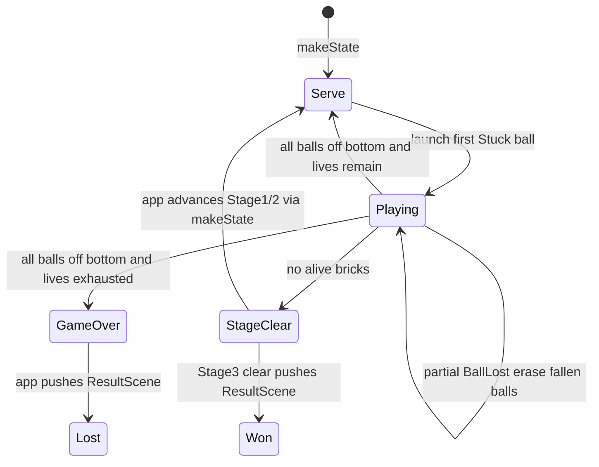
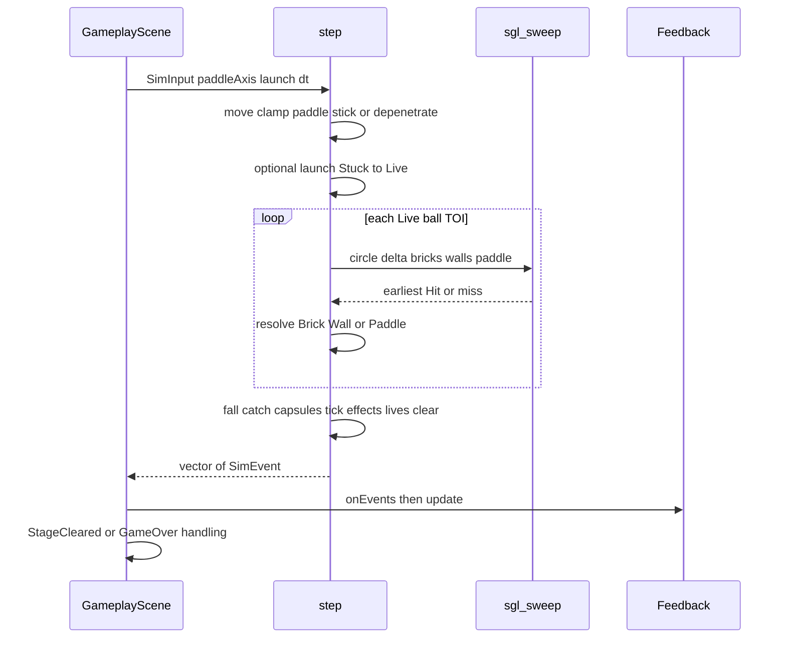

# Arkanoid physics and states

How breakout motion and the play session work in the headless sim (`games/arkanoid/sim/`) and how the app reacts. Facts mirror `Physics.cpp`, `Levels.cpp`, and `engine/collision/`. Reference tables live in [sim.md](../reference/sim.md) and [engine-collision.md](../../../../docs/reference/engine-collision.md).

Design space is **1280×720** with **+y down**. `Ball::pos` is the top-left of a 16×16 sprite; the collision circle center is `pos + (ballRadius, ballRadius)` with `ballRadius = 8`.

## Ball flight

Each live ball carries a velocity `vel`. Target speed is always

\[
s = \texttt{ballSpeed} \times \texttt{ballSpeedMultiplier}(\textit{effects})
\]

where `ballSpeed` is the length of `launchVelocity` \(\approx 393.95\) (`Tuning.hpp`), and the Slow effect multiplies by `slowFactor` \(0.6\) (otherwise \(1\)). After launch, wall bounce, brick bounce, and paddle bounce, `setBallSpeed` renormalizes `vel` to length \(s\). There is no separate max-speed clamp beyond that target.

Stuck balls have zero velocity and are glued to the paddle each `step`. Launch (`SimInput::launch`) turns the first Stuck ball Live with direction of `launchVelocity`, scaled to \(s\).

After every speed set, `enforceMinVertical` keeps \(|v_y| \ge s \sin 15^\circ\). If the vertical component is too small, \(v_x\) and \(v_y\) are rebuilt from \(s\) and the previous signs so the path is never nearly horizontal.

Integration is not a single Euler step. For each Live ball, `integrateLiveBall` runs a time-of-impact (TOI) loop: `remaining` starts at \(1\), up to `maxToiIterations` (\(4\)) substeps. Each substep proposes

\[
\Delta = \textit{vel} \cdot (\textit{dt} \cdot \textit{remaining})
\]

and asks `sgl::sweep` for the earliest hit in \(t \in [0,1]\). On a miss the ball moves by the full \(\Delta\). On a hit it moves by \(\Delta \cdot t\), resolves the obstacle, then continues with \(\textit{remaining} \leftarrow \textit{remaining} \cdot (1 - t)\).

## Swept collision

`sgl::sweep(circle, delta, aabb)` (`Collision.cpp`) returns optional `Hit{time, normal}`:

1. Already overlapping → \(t = 0\) with the `intersect` normal.
2. Else slab-intersect the ray against the AABB expanded by radius (Minkowski disk).
3. Corner pockets use a ray–circle test against the corner; face hits keep the slab entry time and axis normal.

Candidates per substep: every alive brick AABB, three exterior wall AABBs (left / right / top, thickness \(64\)), and the paddle AABB. The earliest \(t\) wins. There is no bottom wall; balls that reach \(y \ge 720\) are handled later as fallen.

### Bricks (seam)

All alive bricks with \(|t - t_{\mathrm{best}}| < 10^{-4}\) die in one resolution. Each contributes \(+10\) score, a `BrickDestroyed` event, and optionally a capsule if `Brick::drop` is set. Reflection uses the normalized sum of those hit normals (fallback: the best single normal).

### Walls

`bounceOutOfWalls` reflects off every exterior wall the circle still overlaps (`intersect`), pushes the center out by depth \(+ 0.01\), then renormalizes speed. If nothing overlaps, it reflects once with the sweep normal and a small separation push. Emits `WallHit`.

### Paddle

Paddle hits do **not** use `reflect`. See below.

## Reflection math

Engine helper (walls and bricks):

\[
\mathbf{v}' =
\begin{cases}
\mathbf{v} & \text{if } \mathbf{v}\cdot\mathbf{n} \ge 0 \\
\mathbf{v} - 2\,(\mathbf{v}\cdot\mathbf{n})\,\mathbf{n} & \text{otherwise}
\end{cases}
\]

(`sgl::reflect` in `Collision.cpp`). Moving away or sliding leaves \(\mathbf{v}\) unchanged.

## Paddle hit angle

`applyPaddleBounce` maps horizontal hit position to launch angle from vertical:

\[
o = \mathrm{clamp}\!\left(\frac{c_x - p_c}{w/2},\,-1,\,1\right),\quad
\alpha = o \cdot 60^\circ
\]

\[
\mathbf{v} = s\,(\sin\alpha,\,-\cos\alpha)
\]

where \(c_x\) is the ball center \(x\), \(p_c\) the paddle center \(x\), and \(w\) the current paddle width. Center hit \(\Rightarrow\) straight up; left/right edges tilt by up to \(\pm 60^\circ\). Then `enforceMinVertical` runs again. Emits `PaddleHit`.

Live balls that already overlap the paddle after paddle motion are depenetrated (lift above if center is above paddle midline; else push sideways in the paddle move direction) so they do not stick inside the paddle AABB.

## Bricks, score, drops

Bricks have no hit-point counter: `Brick::alive` flips false on first TOI hit. Score adds `scorePerBrick` (\(10\)). Capsules spawn at the brick box position when `drop` is set.

Donor rule in `makeState(StageId)`: among live mask cells in row-major order, live index \(i\) with \(i \bmod 4 = 0\) gets `drop = PowerUpKind((i/4) \bmod 4)` (Wide, MultiBall, Slow, ExtraLife). Killing that brick emits `BrickDestroyed` and pushes a `Capsule`.

## Game state machine

Sim flags: `BallMode` (Stuck / Live), `cleared`, `over`, `lives`, `stage`. Stage progression after clear is **app** logic (`GameplayScene::advanceFrom`), not inside `step`.

- **Serve:** Stuck ball on paddle; confirm launches (`BallLaunched`).
- **Playing:** TOI integration, capsules, timed effects.
- **Ball lost:** some but not all balls below the arena → one `BallLost` per fallen ball, then erase them.
- **Life lost:** every ball below → `LifeLost`, decrement `lives`; if lives remain, replace with one Stuck ball; else `over` + `GameOver`.
- **Stage clear:** non-empty brick list, none alive → `cleared` + `StageCleared{stage}`. Empty brick vector does not clear.
- **Advance:** Stage1→Stage2 and Stage2→Stage3 keep score/lives via `makeState(next, score, lives)`. Stage3 clear ends the round as a win.

When `cleared` or `over`, further `step` calls return no events and move nothing.

## One `step` tick

## App consumption of `SimEvent`

`GameplayScene::update` calls `step`, then `Feedback::onEvents`. Each event plays exactly one sound (`Sounds` / `SoundIds`). `BrickDestroyed` also emits a 12-particle burst tinted with the brick color (`ParticleSystem` on `Layer::Overlay`). Stage and game-over outcomes are handled after feedback: advance stage, or `finishRound` → high-score insert/save → `PushScene` result overlay. Pause is only requested while `!cleared && !over`.
