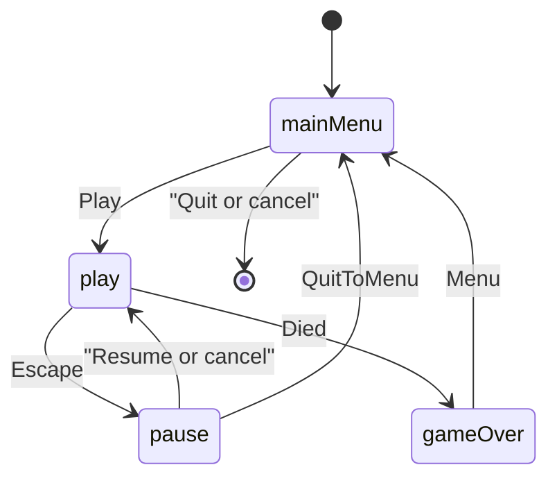

# Asteroids scene flow

The window is a consumer of `AsteroidsGame`. Thrust, turning, shots, rock splits, wrapping, score, and death stay in `asteroids_sim` ([sim](../reference/sim.md)). Scenes map `InputState` to `SimInput`, call `step`, and turn `ship()`, `rocks()`, `bullets()`, and `score()` into draw commands. They do not move the ship themselves.

`main` owns the action map, the font id, and the seed for the whole `App::run()`. Factories copy `AppServices` by value; the `AsteroidsActions` reference inside it must outlive the stack. `Tuning` is a value, so a test can widen `shipRadius` before it builds `play` and force a rock overlap on the first step.

Play replaces the menu, so a run is a single scene until pause or death. Pause is an overlay (`opaque` false): `RequestPause` (Escape, P, or focus loss) asks the stack to push the pause factory while `PlayScene` is pausable. Resume, the pause key, and cancel pop that overlay and leave the same `AsteroidsGame` in place. Menu pops the overlay and then replaces play with the main menu, so the abandoned run is not left under the menu.

Death replaces play with game over. The sim has already stopped (`over()` and a `Died` event). Menu or cancel returns to the main menu. The score on that screen is the sim total for the run that just ended.
