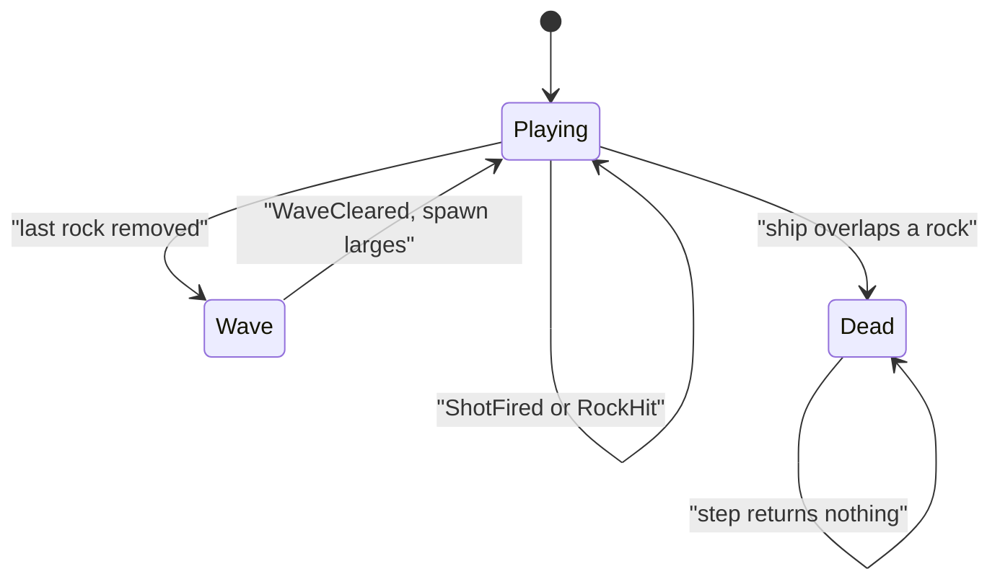

# Asteroids sim

Headless Asteroids rules in `namespace sgl::asteroids`. Static library target `asteroids_sim` links `PUBLIC` `sgl_core` only. No SFML, and no `sgl_collision`: overlaps are circle–circle tests in this sim. Include as `<asteroids/sim/X.hpp>`.

The world is `kWorldW` × `kWorldH` (1280 × 720). **Heading `0` points along +X. Positive heading turns toward +Y (counter-clockwise).** Every ship, bullet, and rock position is wrapped into `[0, kWorldW) × [0, kWorldH)` after it moves.

`over() == false` is Playing. `over() == true` is Dead. Wave is not stored: it is the empty-field transition inside the `step` that removed the last rock.

## Types

| Name | Role |
|------|------|
| `Vec2f` | `sgl::Vec2<float>` |
| `kWorldW`, `kWorldH` | 1280 and 720 |
| `RockSize` | `Large`, `Medium`, `Small` |
| `Tuning` | thrust, turn rate, bullets, radii, scores, `initialLargeRocks` (default 4) |
| `SimInput` | `thrust`, `rotateCw`, `rotateCcw`, `fire` |
| `AsteroidsEvent` | `ShotFired`, `RockHit`, `Died`, or `WaveCleared` |
| `ShipView` | `pos`, `vel`, `heading`, `radius` |
| `BulletView` | `pos`, `radius` |
| `RockView` | `pos`, `size`, `radius` |

`RockHit.score` is the points awarded for that rock (`largeScore`, `mediumScore`, or `smallScore`), not the running total. `score()` is the running total. `ShotFired`, `Died`, and `WaveCleared` carry no fields.

`rotateSpeed` is radians per second. There is no drag. Randomness is `sgl::Pcg32` seeded by the constructor. The same seed and the same inputs yield the same ship, bullets, rocks, and score.

## AsteroidsGame

`AsteroidsGame(seed, tuning)` places the ship at `(kWorldW / 2, kWorldH / 2)` with heading `0`, velocity `0`, score `0`, and `over() == false`. It then spawns the first wave. That spawn does not emit `WaveCleared`.

A fresh wave is `initialLargeRocks` large rocks on a ring around the ship. Rock `i` sits at angle `2π i / count` from world +X (not from the ship heading), at distance `shipRadius + largeRadius + 180`. It drifts outward along that angle. Drift speed is `uniformFloat(18, 34)`. If wrapping would put a rock closer than `shipRadius + largeRadius + 64`, the sim tries up to eight new angles, then places it half a world away from the ship. `initialLargeRocks <= 0` spawns nothing.

`step(input, dt)`:

1. Returns an empty vector when `over()` is already true. State does not change.
2. Negative `dt` is treated as zero. One call integrates once (no substeps).
3. `rotateCcw` adds `rotateSpeed * dt` to heading. `rotateCw` subtracts it. Both together cancel. Heading is not wrapped.
4. `thrust` adds `heading * thrustAccel * dt` to velocity, then clamps the speed to `maxShipSpeed`. The ship then moves by `velocity * dt` and wraps.
5. While `fire` is held, at most one bullet is spawned per step, and only after `fireCooldown` seconds since the previous shot. The first shot is immediate. The bullet starts at the ship position. Its velocity is `heading * bulletSpeed` (ship velocity is not added). The event is `ShotFired`. Drawn radius is always `3`.
6. Bullets and rocks move, then wrap. A bullet older than `bulletLifetime` can still hit this step; if it does not, it is removed.
7. Each bullet hits at most one rock. Circles overlap when the toroidal distance (shortest wrap on each axis) is less than or equal to the sum of radii. A hit adds that rock's score, emits `RockHit`, and consumes the bullet.
8. `Large` spawns two `Medium` rocks, `Medium` spawns two `Small` rocks, and `Small` is removed. Children appear at the parent position. Their directions are the parent's velocity angle plus and minus a spread from `uniformFloat(0.22, 0.48)`, with speeds about `48` (medium) and `64` (small), each scaled by `uniformFloat(0.9, 1.1)`. A stationary parent uses angle `0`. Children are not hit by bullets until a later step.
9. The ship is tested after bullet hits. Overlap emits `Died` and sets `over()`. Later `step` calls return no events.
10. If the ship survived and this step removed the last rock, the sim emits `WaveCleared` and spawns another wave of `initialLargeRocks` large rocks.

Bullet hits are resolved before the ship check, so a bullet that destroys the only rock overlapping the ship prevents `Died` on that step. `bullets()` and `rocks()` are the views rebuilt at the end of construction and at the end of each step that still runs.
