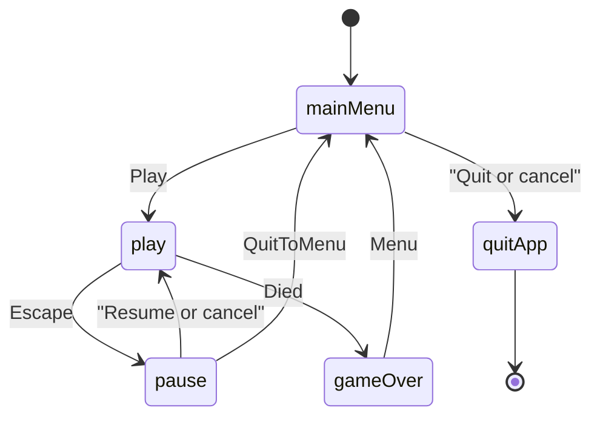

# Dodger scene flow

The window is a consumer of `DodgerGame`. Paddle motion, hazard spawns, clears, score, and death stay in `dodger_sim` ([sim](../reference/sim.md)). Scenes map `InputState` to `SimInput`, call `step`, and turn `paddle()`, `hazards()`, and `score()` into draw commands. They do not move the paddle themselves.

`main` owns the action map, the font id, the seed, the audio device, the sound ids, the scores path, and the high-score table for the whole `App::run()`. Factories copy `AppServices` by value; the references inside it (`DodgerActions`, `AudioI`, `HighScoreTable`) must outlive the stack. `Tuning` is a value, so a test can widen the paddle and set a hazard speed before it builds `play`, then land a hazard on the paddle in one step.

Play replaces the menu, so a run is a single scene until pause or death. Pause is an overlay (`opaque` false): `RequestPause` (Escape, P, or focus loss) asks the stack to push the pause factory while `PlayScene` is pausable. Resume, the pause key, and cancel pop that overlay and leave the same `DodgerGame` in place. Menu pops the overlay and then replaces play with the main menu, so the abandoned run is not left under the menu.

Death replaces play with game over. The sim has already stopped (`over()` and a `Died` event). `PlayScene` feeds that step's events to `Feedback` before the replace, so the death blip plays on `Died`. `HazardCleared` stays silent. Game over inserts the sim score into the high-score table (capacity 5), shows the ranking lines, and saves them. A failed save stays on the scene. Menu or cancel returns to the main menu. Quit from the main menu, or cancel there, requests `QuitApp`. The scene does not close the platform. The score on that screen is the sim total for the run that just ended.
