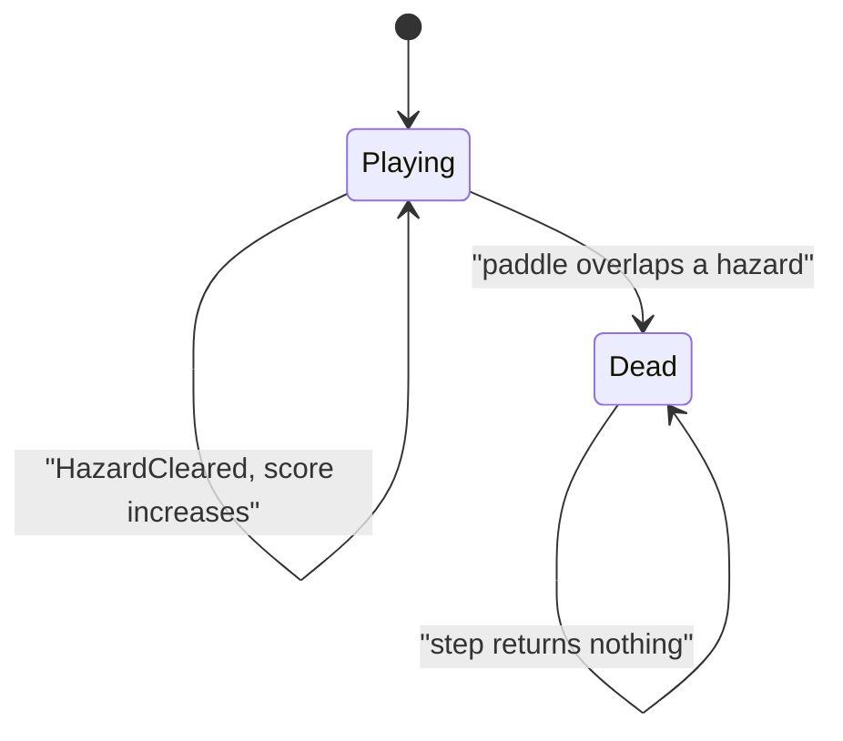

# Dodger sim

Headless Dodger rules in `namespace sgl::dodger`. Static library target `dodger_sim` links `PUBLIC` `sgl_core` only. No SFML, and no `sgl_collision`: overlaps use `sgl::Rect<float>::intersects`. Include as `<dodger/sim/X.hpp>`.

The field is `kWorldW` × `kWorldH` (1280 × 720). The paddle's Y is always `kPaddleY` (660). Hazards fall downward (+Y).

`over() == false` is Playing. `over() == true` is Dead. Dead is stored on the sim; later `step` calls return an empty event vector and leave the state unchanged.

## Types

| Name | Role |
|------|------|
| `Vec2f` | `sgl::Vec2<float>` |
| `kWorldW`, `kWorldH` | 1280 and 720 |
| `kPaddleY` | 660 |
| `Tuning` | paddle speed and size, hazard size and speed, `spawnInterval` (default 0.5 s) |
| `SimInput` | `left`, `right` |
| `DodgerEvent` | `HazardCleared` or `Died` |
| `PaddleView` | `pos`, `size` |
| `HazardView` | `pos`, `size` |

`HazardCleared` and `Died` carry no fields. `score()` is the number of hazards that have left the bottom of the field. Randomness is `sgl::Pcg32` seeded by the constructor. The same seed and the same inputs yield the same paddle, hazards, score, and events.

## DodgerGame

`DodgerGame(seed, tuning)` places the paddle at `((kWorldW - paddleW) / 2, kPaddleY)` with size `(paddleW, paddleH)`. Score is 0, `over()` is false, the hazard list is empty, and the spawn timer starts at 0. Nothing spawns in the constructor.

`step(input, dt)`:

1. Returns an empty vector when `over()` is already true. State does not change.
2. `left` moves the paddle by `-paddleSpeed * dt`. `right` moves it by `+paddleSpeed * dt`. Both together cancel, and neither held leaves X unchanged. X is clamped to `[0, kWorldW - paddleW]`. Y is set back to `kPaddleY`.
3. `dt` is added to the spawn timer. Each time the timer reaches `spawnInterval`, it subtracts one interval and spawns one hazard. A `dt` that covers several intervals spawns that many hazards, in order. The timer starts at 0, so the first hazard appears only after the first interval has elapsed. A non-positive `spawnInterval` does not spawn. The column count is `floor(kWorldW / hazardW)`. Column is `rng.uniformBelow` of that count. The hazard is placed at `(column * hazardW, -hazardH)` with size `(hazardW, hazardH)`.
4. Every hazard then moves by `hazardSpeed * dt` on Y. Each hazard whose `pos.y > kWorldH` is removed, emits `HazardCleared`, and increments `score()`.
5. After moves, spawns, and clears, the paddle AABB is tested against each remaining hazard. The first overlap emits `Died` and sets `over()`. One `Died` is emitted. Clears from this same step stay in the event vector ahead of `Died`.

`paddle()` is a copy of the paddle view. `hazards()` is the live list rebuilt by the step that still runs.
