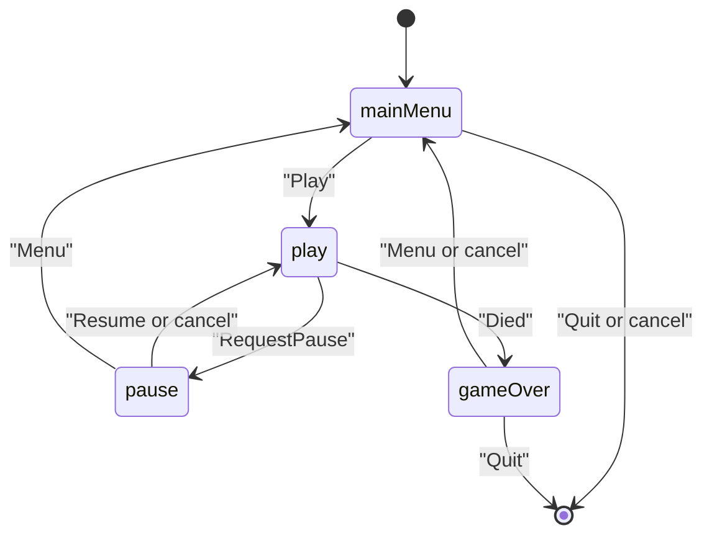

# Snake scene flow

The window is a consumer of `SnakeGame`. Movement, food, score, and death stay in `snake_sim` ([sim](../reference/sim.md)). Scenes map `InputState` to `SimInput`, call `step`, and turn `body()`, `food()`, and `score()` into draw commands. They do not move the snake themselves.

`main` owns the action map, the font id, the seed, the audio device, the sound ids, the scores path, and the high-score table for the whole `App::run()`. Factories copy `AppServices` by value; the references inside it (`SnakeActions`, `AudioI`, `HighScoreTable`) must outlive the stack.

Play replaces the menu, so a run is a single scene until pause or death. Pause is an overlay: `RequestPause` (Escape, P, or focus loss) asks the stack to push the pause factory. Resume, the pause key, and cancel pop that overlay and leave the same `SnakeGame` in place. Menu pops the overlay and then replaces play with the main menu, so the abandoned run is not left under the menu.

Death replaces play with game over. The sim has already stopped (`over()` and a `Died` event). `PlayScene` feeds that step's events to `Feedback` before the replace, so the death blip plays on `Died` and the eat blip plays on `Ate`. Game over inserts the sim score into the high-score table (capacity 5), shows the ranking lines, and saves them. A failed save stays on the scene. Menu or cancel returns to the main menu; Quit leaves the app.
