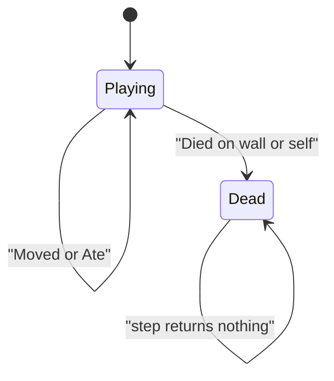

# Snake sim

Headless Snake rules in `namespace sgl::snake`. Static library target `snake_sim` links `PUBLIC` `sgl_core` only. No SFML. Include as `<snake/sim/X.hpp>`.

The board is `kCols` × `kRows` (32 × 18). A 40px cell maps that board onto 1280 × 720; the sim stores cells, not pixels. **+x is Right, +y is Up.** Cell `(0, 0)` is the bottom-left. There is no grid type: a cell is occupied when it appears in `body()`.

`over() == false` is Playing. `over() == true` is Dead.

## Types

| Name | Role |
|------|------|
| `Cell` | `x` / `y` with `operator==` |
| `Dir` | `Up`, `Down`, `Left`, `Right` |
| `kCols`, `kRows` | 32 and 18 |
| `Tuning` | `moveInterval` (default `0.15s`), `startLength` (default 3) |
| `SimInput` | `turn`: `nullopt` keeps `dir()`; the opposite direction is ignored |
| `SnakeEvent` | `Moved`, `Ate{score}`, or `Died` |

`moveInterval` must be positive. The sim does not change it during play.

## SnakeGame

`SnakeGame(seed, tuning)` faces `Dir::Right`. The head is `(kCols / 2, kRows / 2)` and is `body()[0]`. The remaining `startLength - 1` segments trail toward `-x` on that row. `score()` starts at 0. `startLength` must leave every segment inside the row (the default 3 does).

Food is one free cell chosen with `sgl::Pcg32(seed)`. Free cells are scanned with `x` increasing, then `y` increasing from 0, and `uniformBelow(freeCount)` picks the index. The same seed and the same inputs yield the same body, food, and score. When no free cell remains, `food()` is `{-1, -1}` and cannot be eaten.

`step(input, dt)`:

1. Returns an empty vector when `over()` is already true.
2. Applies `turn` once, before movement. A 180° reverse (`Up`/`Down`, `Left`/`Right`) leaves `dir()` unchanged. Any other direction replaces `dir()` immediately, including when `dt` is zero.
3. Adds `dt` to an accumulator. Each time it reaches `moveInterval`, the snake advances one cell and the interval is subtracted. One `step` can emit several events. Leftover time carries to the next `step`.

Advancing one cell:

| Next cell | Result |
|-----------|--------|
| Outside `[0, kCols) × [0, kRows)` | `Died`, `over()`, body unchanged |
| `food()` | Head steps onto it, tail stays (length + 1), `score` + 1, `Ate` carries the new score, food moves to a new free cell |
| Any body cell, except the tail when this step does not eat | `Died`, `over()`, body unchanged |
| Otherwise | Head advances, tail drops, `Moved` |

The tail is safe on a non-eating step because it vacates. On an eating step the tail stays, so it blocks. After `Died`, later `step` calls return no events and leave the state unchanged.
