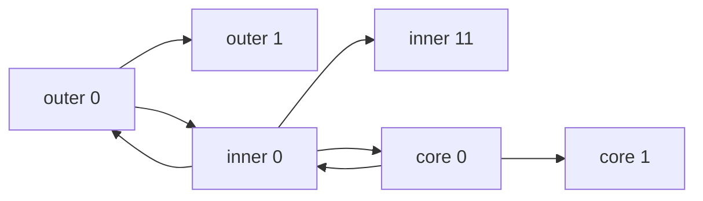
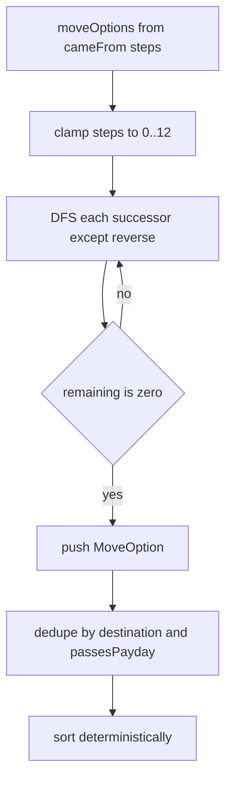

# Board graph math

The board is **not** hexagonal. It is three **concentric directed rings** (40 nodes on the standard board) stored as a CSR adjacency list. Movement walks directed edges; junctions (out-degree > 1) create path choices. Screen positions come from polar layout in `LayoutView`. Exact APIs: [reference/sim.md](../reference/sim.md), [reference/app.md](../reference/app.md).

## Rings, nodes, edges

`standardBoard()` (`BoardLayouts.cpp`) builds:

| Ring | `RingSlot.ring` | Node ids | Slots | Ring direction |
|------|-----------------|----------|-------|----------------|
| Outer | 0 | 0..23 | 0..23 | clockwise: \(i \to (i+1)\bmod 24\) |
| Inner | 1 | 24..35 | 0..11 | counter-clockwise: slot \(s \to (s+11)\bmod 12\) |
| Core | 2 | 36..39 | 0..3 | clockwise: slot CW |

**Bridges** (both directions):

- Outer slots 0/6/12/18 ↔ inner 0/3/6/9 (ids 24/27/30/33).
- Inner 0/6 (24/30) ↔ core 0/2 (36/38).

Junctions are nodes with more than one successor: outer bridge ends `0,6,12,18`, inner bridge ends `24,27,30,33`, and core bridge ends `36,38` (ten nodes). Each still keeps its ring successor plus the bridge.



At outer 0 the player may continue clockwise on the outer ring or cross to the inner ring (and later to the core at inner 0).

## CSR representation

`BoardGraph::build` validates dense ids `0..n-1`, no dead ends, strong connectivity (DFS forward and on the transpose from node 0), and exactly one `Payday` tile. It then packs edges as:

- `offsets_` — length \(n+1\); successors of node \(i\) occupy `[offsets_[i], offsets_[i+1])`
- `targets_` — flat list of destination `NodeId`s

`successors(id)` returns a `span` into `targets_`. CSR keeps adjacency contiguous after build (no per-node heap vectors), which suits dense successor scans in pathing.

## Pathing: `moveOptions`

```cpp
moveOptions(board, from, cameFrom, steps) -> vector<MoveOption>
```

Algorithm (`Pathing.cpp`):

1. `steps < 0` → empty; clamp `steps` to at most 12; `steps == 0` → stay at `from`, `passesPayday` false.
2. Locate the unique Payday node.
3. Depth-first walk of exactly `steps` edges. At each step skip the **immediate reverse** (`next == prev`). The starting `cameFrom` blocks leaving back along the edge just taken into `from`.
4. `path` is length `steps+1` and includes the start. `passesPayday` is true iff some node **after** the start equals Payday.
5. Deduplicate by `(destination, passesPayday)`, keeping the lexicographically smaller `path`.
6. Sort by destination, then `passesPayday` (false before true), then path.

**Cycles:** revisiting a node is allowed. Only immediate edge reversal is forbidden, so a long roll can loop a ring and still produce a legal walk.

**Branching:** at a junction, each extra successor multiplies the number of walks. With max out-degree \(b\) after reverse filtering, the DFS explores \(O(b^{s})\) walks for \(s\) steps (small board, \(s \le 12\)). Dedup is a linear scan over walks; sort is \(O(U\log U)\) on the unique set.



Match rolls **d4+d4** (sum 2..8) then calls `moveOptions`; optional Momentum ±1 (floor 1) rebuilds options. The player picks a `ChooseDestination` matching one option.

## Screen positions

`PlayScene` uses `LayoutView{kBoardOrigin, kBoardRadius}` with

\[
\text{kBoardOrigin} = (640,\,340),\quad \text{kBoardRadius} = 270
\]

(`LayoutView.hpp`). Ring radii: outer \(R\), inner \(0.62R\), core \(0.30R\). Slot count per ring: 24 / 12 / 4.

Polar placement (slot 0 at top; screen \(Y\) grows downward):

\[
\theta = \frac{\text{slot}}{\text{count}} \cdot 2\pi
\]

\[
x = o_x + r\sin\theta,\qquad y = o_y - r\cos\theta
\]

Node draw radius: \(R \cdot \pi \cdot 0.7 / 24\) (outer chord half-spacing × 0.7).
