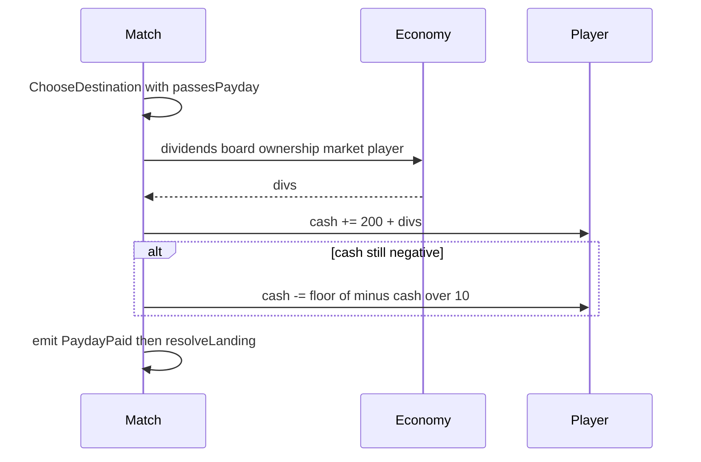
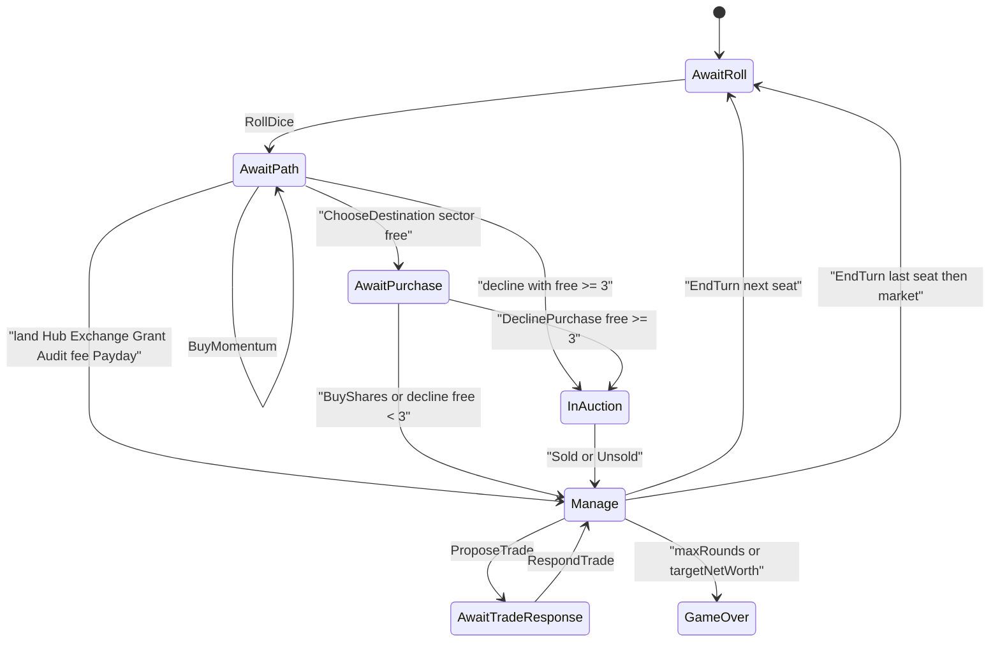

# Economy rationale

All money and market indexes are **integer-only** (`Money` is `std::int64_t`; `Percent` scales with truncating division). Formulas and signatures: [reference/economy.md](../reference/economy.md). Turn machine and events: [reference/sim.md](../reference/sim.md).

## Market cycle

Each of the six `Sector` values has an index in \([50, 200]\), starting at 100. End of round (`Match::` `endOfRound` after the last seat ends a turn):

1. Increment `round`.
2. Draw one `MarketEventCard` from a 12-card deck (per sector: \(+20\) and \(-20\)), Fisher–Yates-shuffled with `sgl::Pcg32` (`uniformBelow`). Insider peek may consume a previously revealed top card.
3. `applyShift(market, sector, delta)` then `clampIndex`.
4. `revertTowardCenter`: for each index \(v\),

\[
\Delta = \left\lfloor\frac{100 - v}{10}\right\rfloor,\qquad v \leftarrow v + \Delta
\]

then clamp again to \([50, 200]\).

Card effects (`MarketCrash` −30, `ShortSqueeze` +30) call the same `applyShift` / clamp path mid-turn.

## Shares, price, fees

Each sector tile has **10** shares (players + bank). Control is ≥6 shares. Share price:

\[
\text{unit} = \left\lfloor\frac{\text{basePrice}}{10}\right\rfloor,\qquad
\text{price} = \mathrm{scale}(\text{unit},\,\text{index})
\]

Landing fee \(F\) layers level, index, and synergy, then scales by other players’ share fraction of 10 (bank ignored). Payouts conserve `total` (remainder to largest other holder; lower `PlayerId` on ties). Embargo zeroes fees until end of next round. Exact expressions: [reference/economy.md](../reference/economy.md).

## Payday, dividends, interest

When a chosen path has `passesPayday`, `applyPayday` runs before landing resolve:

1. Salary `Money{200}`.
2. Dividends: per held sector share, \(\lfloor\mathrm{scale}(\text{baseFee},\,\text{index})/10\rfloor\).
3. If cash is still negative, interest \(\lfloor(-\text{cash})/10\rfloor\) (10%) is subtracted.

Landing on the Payday tile itself does not pay again (salary already came from `passesPayday`).

## Purchase, debt, liquidation

Free shares → `AwaitPurchase` (buy up to `min(3, free)` or decline; decline with ≥3 free opens auction). Occupied sector → fee. If cash cannot cover the fee, `liquidationPlan` sells cheapest shares first at 80% mark-to-market to the bank; remaining shortfall becomes **debt** (negative cash). Debtors still move and collect dividends but cannot buy, bid, or upgrade (enforced in `legalCommands` / apply checks).

Net worth = cash + share MTM + 50% of cumulative upgrade spend on controlled tiles. Game over when `round > maxRounds` or any seat reaches `targetNetWorth`.

## Turn phases

Optional Manage actions: one `PlayCard`, up to three trades, upgrade/sell/`BuyCard` at Exchange (100). Hub draws into hand if not full. Commands go through `Match::apply` only.
