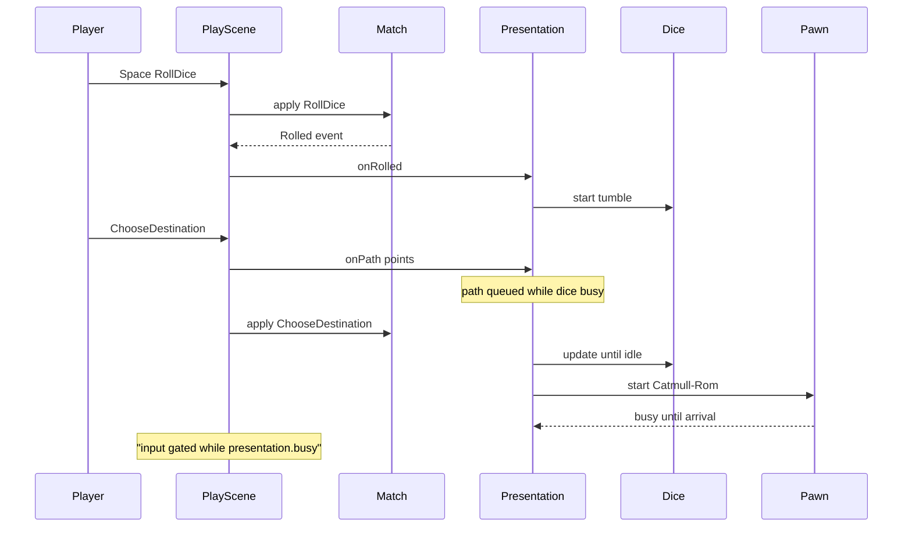

# Dice and pawn presentation

Cosmetic roll and path motion in `namespace sgl::syndicate`. Match RNG is untouched: `DiceAnimator` owns a separate `sgl::Pcg32` seeded with `seed ^ 0xD1CE`. Include as `<syndicate/app/DiceAnimator.hpp>`, `Presentation.hpp`, `PawnAnimator.hpp`. Broader play flow: [app.md](app.md).

## DiceAnimator

| API | Behavior |
|-----|----------|
| `DiceAnimator(uint64_t seed)` | Cosmetic RNG only |
| `start(int finalRoll)` | Split roll into two d4 faces; begin tumble |
| `update(Seconds dt)` | Advance tumble / pop |
| `busy()` | True while tumble or pop active |
| `fastForward()` | Snap to final faces; clear busy |
| `render(queue, center, theme)` | Two rounded dice + pips while busy; no-op when idle |
| `faceA()` / `faceB()` | Current pip counts (1..4) |

### Durations and constants (`DiceAnimator.cpp`)

| Constant | Value | Role |
|----------|-------|------|
| `kBaseInterval` | `0.04` s | First face-change time |
| `kIntervalGrowth` | `1.35` | Interval \(k\): \(0.04 \times 1.35^{k}\) |
| `kTumbleEnd` | `0.9` s | Snap to final faces; start pop |
| `kPopDur` | `0.25` s | `easeOutBack` scale from `1.15` → `1` |
| `kDieSize` / `kDieGap` | `48` / `16` | Die size and gap (scaled while popping) |
| `kCorner` / `kPipR` | `8` / `4` | Rounded rect corner; pip radius |

Total busy time ≈ `1.15` s unless `fastForward`. `splitFinal` picks `finalA` in a legal d4 range so `finalA + finalB == finalRoll`.

## Presentation

Sequences dice then pawn path.

| API | Behavior |
|-----|----------|
| `Presentation(PawnAnimator&, uint64_t seed)` | Owns `DiceAnimator` |
| `onRolled(int roll)` | `dice_.start(roll)` |
| `onPath(PlayerId, points)` | If dice busy, queue path; else `animator.start` |
| `update(dt)` | Update dice; when dice finishes, start queued path on a **later** frame (path does not share the same large `dt`); then update pawns |
| `busy()` | `dice.busy() \|\| queued \|\| animator.busy()` |
| `fastForward()` | Finish dice, start queued path, `animator.finishAll()` |
| `render(...)` | Forwards to `dice_.render` only |

## PawnAnimator

| API | Behavior |
|-----|----------|
| `PawnAnimator(const LayoutView&)` | Up to `kMaxPlayers` seats |
| `reset(id, RingSlot)` | Snap to layout position |
| `start(id, points)` | Catmull-Rom samples (`catmullRom(points, 8)`) + `ArcLengthTable`; duration \(T = \min(0.25 \times \text{hops},\, 1.6)\) s |
| `update(dt)` | Distance along table: \(\mathrm{length} \times \mathrm{easeInOutCubic}(t/T)\) |
| `position(id)` | Animated pos + seat offset \((\mathrm{id}-1.5)\times 12\) on \(X\) |
| `busy()` | Any seat animating |
| `finish` / `finishAll` | Snap to path end |
| `setSpeed` | Stored; duration formula above does not use it |

## Input gate (`PlayScene`)

While `presentation.busy()`: pointer press or **Space** (`actions.roll`) calls `fastForward()` and does **not** apply a command. Help, action bar, and bot commands wait until idle. An open `TradeComposeOverlay` takes the human's input until **Escape** closes it or Confirm applies `ProposeTrade`. Animation never blocks the fixed-step loop—only command input.

`drainFeedback` calls `onRolled` from `Rolled` events. `ChooseDestination` calls `tryStartPathAnimation` → layout positions along `MoveOption::path` → `onPath` **before** `Match::apply`.

## Tests (`tests/syndicate/app/`)

| Suite | Coverage |
|-------|----------|
| `DiceAnimatorTest` | Tumble intervals non-decreasing before 0.9 s; settle faces sum to 7; `fastForward` clears busy |
| `PresentationTest` | Path waits for dice; `fastForward` ends both |
| `PawnAnimatorTest` | Ease-in-out path, `busy()`, distinct same-slot seat offsets |
