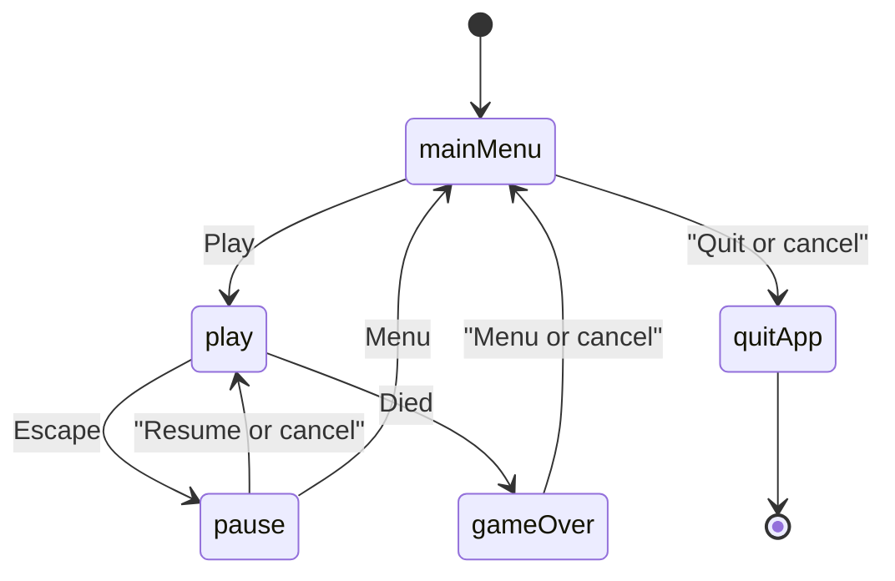

# Tappy scene flow

The window consumes `TappyGame`. Flap, scroll, gates, score, and death stay in `tappy_sim`. Scenes map pressed flap, call `step`, and draw with camera-relative coordinates.

High scores (`tappy.scores`, capacity 5) update on game over. Art prefers atlas sprites and falls back to colored rects.
