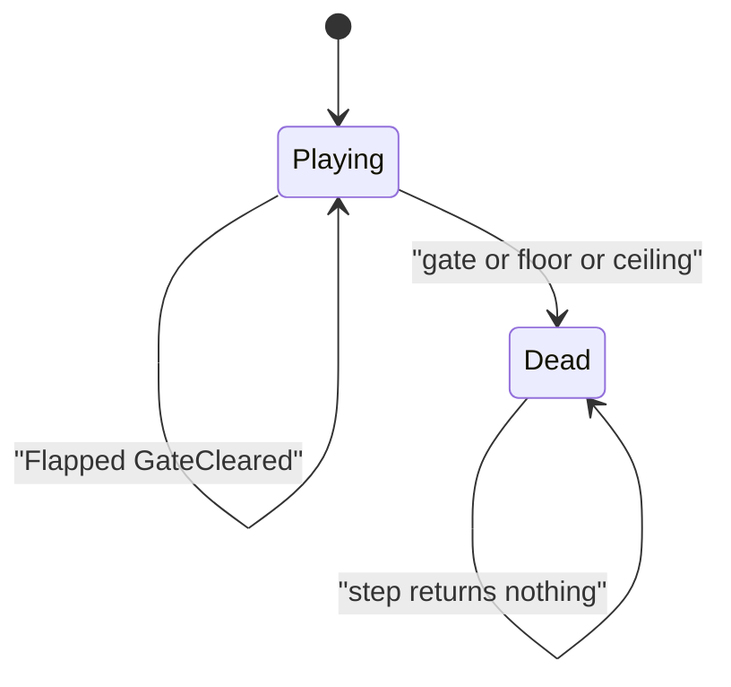

# Tappy sim

Headless Flappy-style rules in `namespace sgl::tappy`. Target `tappy_sim` links `PUBLIC` `sgl_core` only. Include `<tappy/sim/X.hpp>`.

World is `kWorldW`×`kWorldH` (1280×720). +Y is up. The player auto-advances in +X; `cameraLeft = player.x - 0.28 * kWorldW`.

## Rules in `step`

1. Empty when `over()`.
2. If `flap` → `vy = flapSpeed`, emit `Flapped`.
3. Gravity on `vy`, clamp to `[−maxFall, maxRise]`, integrate Y.
4. `pos.x += scrollSpeed(distance) * dt`; update `distance`.
5. Spawn gates ahead (`gateSpacing`); cull behind camera; clear when player right passes gate right → `GateCleared`, `score++`.
6. AABB vs gate pillars → `Died`. Floor `y < 0` or ceiling `y + h > kWorldH` → `Died`.

Gap height: `max(gapMin, gapStart - gapShrink * gateX)`. Gap center from `Pcg32` within margins.
