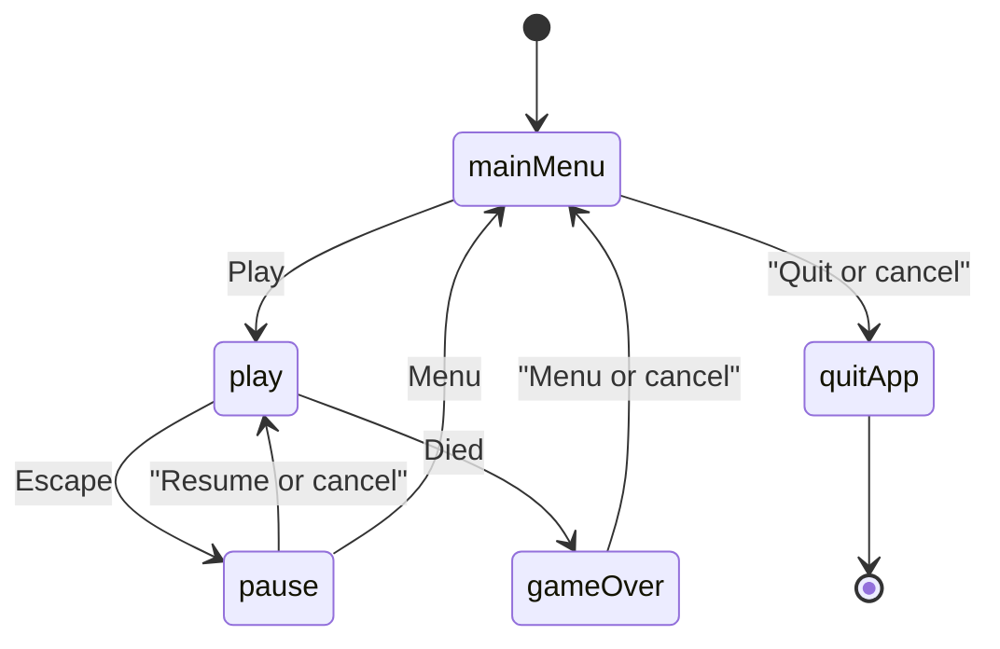

# Tower scene flow

The window is a consumer of `TowerGame`. Running, jumping, platforms, the rising camera, score, and death stay in `tower_sim` ([sim](../reference/sim.md)). Scenes map `InputState` to `SimInput`, call `step`, and turn `player()`, `platforms()`, `cameraBottom()`, and `score()` into draw commands. They do not move the player themselves.

`main` owns the action map, the font id, the audio device, the sound ids, the high-score table, and the seed for the whole `App::run()`. It also owns an optional `SpriteBank` copied by value into `AppServices`. Factories copy `AppServices` by value; the `TowerActions`, `AudioI`, and `HighScoreTable` references inside it must outlive the stack. `Tuning` is a value, so a test can narrow the start platform and raise gravity before it builds `play`, then hold right until the fall emits `Died`.

Play plays a jump blip when jump is pressed and the player is still grounded, then steps. `Feedback` plays land on `Landed` and die on `Died`. Game over inserts that run's score into a five-entry table and saves `tower.scores`. Drawing prefers atlas sprites (`bg/sky`, `plat/ice`, `player/idle`, `player/jump`) and falls back to colored rects when a region is missing ([assets](../reference/assets.md)).

Play replaces the menu, so a run is a single scene until pause or death. Pause is an overlay (`opaque` false): `RequestPause` (Escape, P, or focus loss) asks the stack to push the pause factory while `PlayScene` is pausable. Resume, the pause key, and cancel pop that overlay and leave the same `TowerGame` in place. Menu pops the overlay and then replaces play with the main menu, so the abandoned run is not left under the menu.

Death replaces play with game over. The sim has already stopped (`over()` and a `Died` event). Game over shows that run's score and the high-score table. Menu or cancel returns to the main menu. Quit from the main menu, or cancel there, requests `QuitApp`. The scene does not close the platform.

The sim's +Y points up and the screen's +Y points down. `PlayScene` places each body by `screenY = kViewH - (worldY - cameraBottom)`, using the top of the body as the draw top-left, because a rect's `pos` and a sprite's `position` are that corner. The camera's bottom is the world Y at the bottom of the view, so a higher platform is drawn further up the window. A negative horizontal velocity mirrors the player sprite inside that same box.
