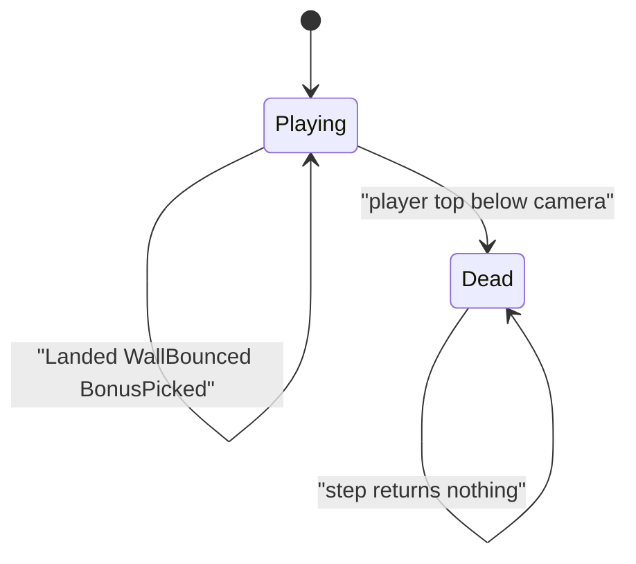

# Tower sim

Headless tower rules in `namespace sgl::tower`. Static library target `tower_sim` links `PUBLIC` `sgl_core` only. No SFML, and no `sgl_collision`. Include as `<tower/sim/X.hpp>`.

+Y is up. The tower has width `kWorldW` (1280). The view is `kViewH` (720) tall. Platform, player, and bonus `pos` is the **bottom-left**. A platform's top is `pos.y + size.y`.

## Types

| Name | Role |
|------|------|
| `BonusKind` | `Speed`, `Jump`, `Points` |
| `Tuning` | run/jump/ice, walls, height accel, bonus spawn/boosts |
| `SimInput` | `left`, `right`, `jump` (held for autojump) |
| `TowerEvent` | `Landed`, `Died`, `WallBounced`, `BonusPicked` |
| `PlayerView` / `PlatformView` / `BonusView` | presentation reads |

`BonusPicked.points` is set only for `Points` (`pointsBonus`). `score()` is `max(height floor, score)` and also grows by point pickups. `runSpeedCap()` / `jumpSpeedEffective()` apply height scale and active Speed/Jump timers.

## Rules in `step`

1. Empty when `over()`.
2. Tick boost timers down.
3. If `jump` and grounded → `vy = jumpSpeedEffective()`, leave ground (held jump = autojump on later landings).
4. Horizontal accel + clamp to `runSpeedCap()`; ice friction when the step started grounded.
5. Integrate X; if past `0` / `kWorldW`, clamp, reverse `vx` by `wallBounce`, optional `wallKick` when falling, emit `WallBounced`.
6. Gravity / Y integrate; one-way land on platform tops → `Landed`.
7. Player AABB vs bonuses → apply Speed/Jump timers or add points, emit `BonusPicked`, remove bonus.
8. Update peak/score; raise `cameraBottom` only upward; spawn/cull platforms and bonuses.
9. Death when player top `< cameraBottom - deathMargin`.

Height scale: `1 + min(heightAccelCap, heightAccel * peakFeet)`. Band spawn may place a bonus above a new platform with probability `bonusChance` (kind uniform in `{Speed,Jump,Points}`).
