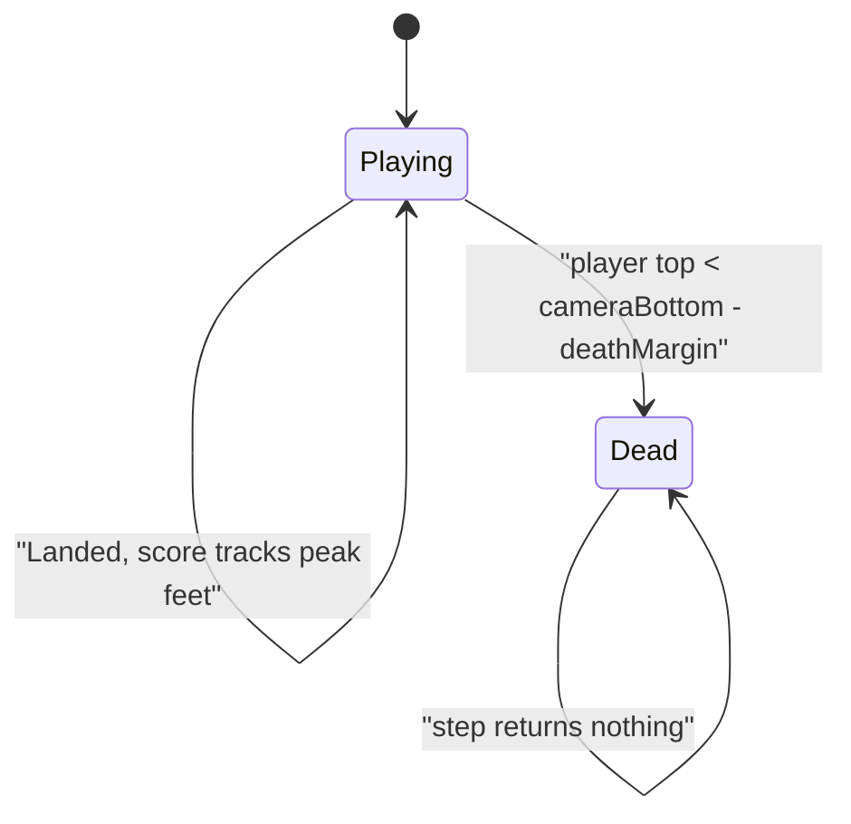
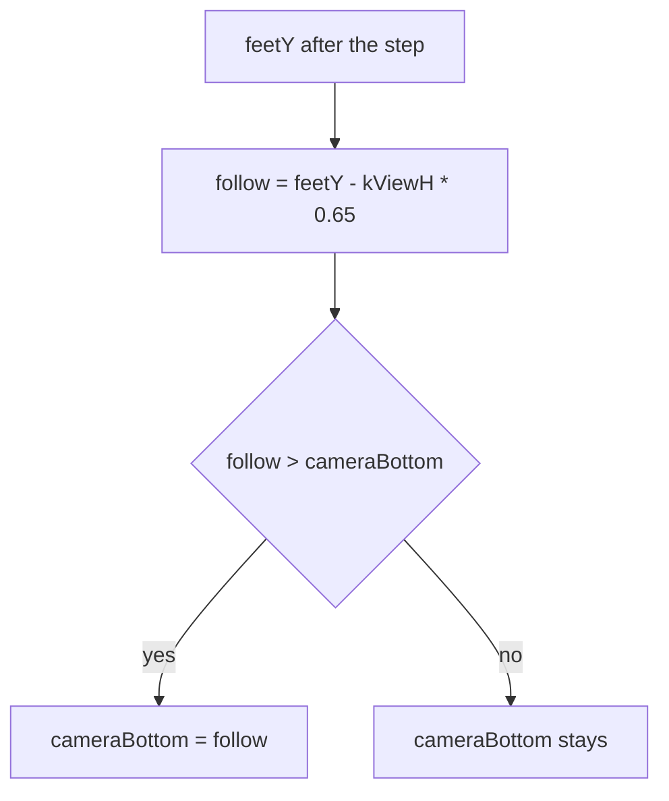

# Tower sim

Headless tower rules in `namespace sgl::tower`. Static library target `tower_sim` links `PUBLIC` `sgl_core` only. No SFML, and no `sgl_collision`. Horizontal overlap uses `sgl::Rect<float>::intersects` on boxes that share a vertical span. Include as `<tower/sim/X.hpp>`.

+Y is up. The tower has width `kWorldW` (1280) and no fixed height. The view is `kViewH` (720) tall, starting at `cameraBottom()`. Platform and player `pos` is the bottom-left corner. A platform's top (the landing surface) is `pos.y + size.y`. The player's feet are `pos.y` and the top of the body is `pos.y + size.y`.

`over() == false` is Playing. `over() == true` is Dead. Dead is stored on the sim; later `step` calls return an empty event vector and leave the state unchanged.

The visible interval is `[cameraBottom, cameraBottom + kViewH]`. Follow keeps the player's feet at 65% of the view height, in the lower portion of the view, with room above for the next platforms. The camera never moves down.

## Types

| Name | Role |
|------|------|
| `Vec2f` | `sgl::Vec2<float>` |
| `kWorldW`, `kViewH` | 1280 and 720 |
| `Tuning` | run, jump, body, platform, death, and band sizes |
| `SimInput` | `left`, `right`, `jump` |
| `TowerEvent` | `Landed` or `Died` |
| `PlayerView` | `pos`, `vel`, `size`, `grounded` |
| `PlatformView` | `pos`, `size` |

`Landed` and `Died` carry no fields. `score()` is `max(score, floor(peak feet Y))` and never decreases. Randomness is `sgl::Pcg32` seeded by the constructor. The same seed and the same inputs yield the same player, platforms, camera, score, and events.

## TowerGame

`TowerGame(seed, tuning)` places the player's feet at `( (kWorldW - playerW) / 2, 0 )` with size `(playerW, playerH)`, velocity 0, and `grounded == true`. The start platform is centered, clamped to `[0, kWorldW]` wide, and its top is `y = 0` (`pos.y = -platformH`). `cameraBottom` starts at `feetY - kViewH * 0.65`. Score is `floor` of that feet Y (0 with the default tuning). Bands above the view are generated immediately.

`step(input, dt)`:

1. Returns an empty vector when `over()` is already true. State does not change.
2. `jump` sets `vel.y = jumpSpeed` and clears `grounded` only when the step starts grounded. A held `jump` is another attempt on the next step, and it still requires ground. Both `left` and `right` cancel. Exactly one of them adds `±moveAccel * dt` to `vel.x`. `vel.x` is then clamped to `[-maxRunSpeed, maxRunSpeed]`. If the step started grounded, `vel.x` is multiplied by `exp(-iceFriction * dt)`.
3. X is integrated. If the body was still grounded and the feet no longer rest on a platform top, `grounded` is cleared. Grounded bodies keep `vel.y` at 0. Airborne bodies subtract `gravity * dt` from `vel.y`, then Y is integrated.
4. Landing is one-way. It runs only when airborne and `vel.y <= 0`. The feet must have been at or above a platform top and end at or below it, and the body must overlap that platform in X. The highest such top wins. Feet snap to that top, `vel.y` becomes 0, `grounded` becomes true, and the step emits one `Landed`. Rising (`vel.y > 0`) passes through platforms.
5. Score becomes `max(score, floor(peak feet Y))`.
6. `cameraBottom = max(cameraBottom, feetY - kViewH * 0.65)`.
7. Each band `n` (`n` starts at 1) has its landing surface at `n * bandHeight`. The sim keeps spawning while that surface is at or below `max(cameraBottom + kViewH, feetY) + 2 * bandHeight`. A non-positive `bandHeight` spawns no bands. Each band places two platforms. Width is `minPlatformW + (startPlatformW - minPlatformW) * exp(-max(surfaceY, 0) / (bandHeight * 8))`, then clamped to `[0, kWorldW]`. X is `rng.uniformFloat(0, kWorldW - width)`. Platforms whose top is below `cameraBottom - kViewH` are removed.
8. If the player's top is below `cameraBottom - deathMargin`, the step emits `Died` and sets `over()`.

`player()` is a copy of the player view. `platforms()` is the live list, start platform first, then bands in order.
