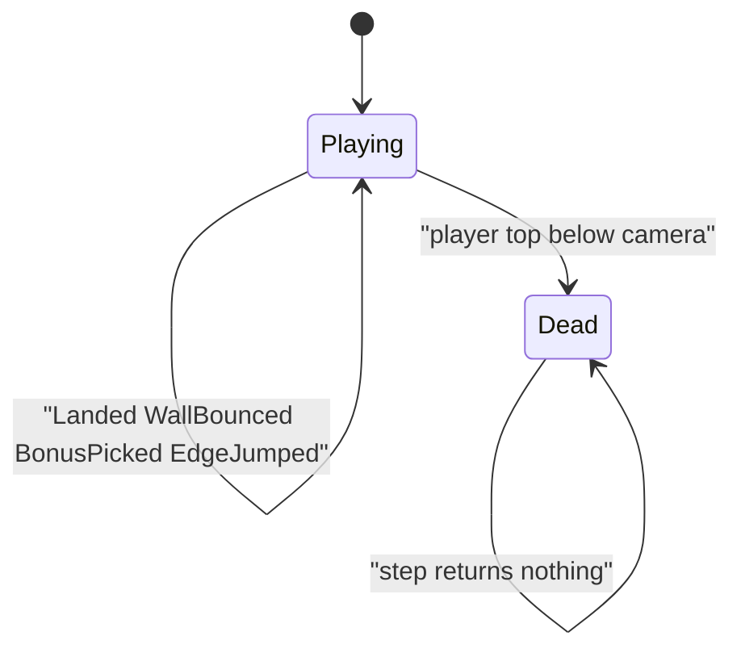

# Tower sim

Headless tower rules in `namespace sgl::tower`. Static library target `tower_sim` links `PUBLIC` `sgl_core` only. No SFML, and no `sgl_collision`. Include as `<tower/sim/X.hpp>`.

+Y is up. The design canvas is `kWorldW`×`kViewH` (1280×720). The **shaft** is `[playLeft(), playRight()]` with `playLeft = wallThickness` and `playRight = kWorldW - wallThickness`. Platform, player, and bonus `pos` is the **bottom-left**. A platform's top is `pos.y + size.y`.

## Types

| Name | Role |
|------|------|
| `BonusKind` | `Speed`, `Jump`, `Points` |
| `Tuning` | run/jump/ice, shaft walls, climb boost, combo, edge jump, bonuses |
| `SimInput` | `left`, `right`, `jump` (held for autojump) |
| `TowerEvent` | `Landed`, `Died`, `WallBounced`, `BonusPicked`, `EdgeJumped` |
| `PlayerView` / `PlatformView` / `BonusView` | presentation reads |

`combo()` is the current chain length (0 before the first land). `runSpeedCap()` / `jumpSpeedEffective()` apply height scale, Speed/Jump timers, and combo jump scale.

## Rules in `step`

1. Empty when `over()`.
2. Tick boost timers; advance `timeSinceLand`.
3. If `jump` and grounded → optional edge mul on support (`EdgeJumped`), `vy = jumpSpeedEffective()` (× edge), leave ground.
4. Horizontal accel + clamp to `runSpeedCap()`; ice friction when the step started grounded.
5. Integrate X; if past shaft edges → clamp, reverse `vx` by `wallBounce`, emit `WallBounced`. Airborne: climb boost `wallKickBase + wallKickSpeedMul * |vx|` (× wall combo mul), refresh combo timer. Grounded: no kick.
6. Gravity / Y integrate; one-way land → update combo/score, `Landed`.
7. Player AABB vs bonuses → apply, emit `BonusPicked`.
8. Peak/score floor; raise `cameraBottom`; spawn/cull platforms and bonuses in the shaft.
9. Death when player top `< cameraBottom - deathMargin` → `combo = 0`, `Died`.

### Combo

On `Landed`: if `timeSinceLand <= comboWindow` then `combo = min(combo+1, comboCap)`, else `combo = 1`. Add `combo * comboPoints` to `score`. Airborne wall bounce sets `timeSinceLand = 0` (keeps the chain without incrementing).

### Spawn

Start slab centered in the shaft. Each band places a wall-biased first platform (alternating L/R) and a sibling within `maxSiblingGap` of its center, both clamped to the shaft.
